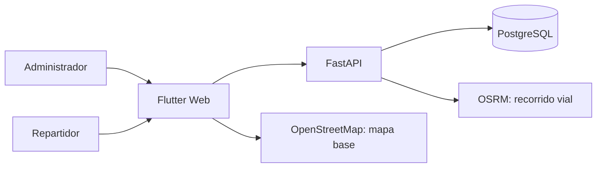

# EcoLogística Huancayo

Optimizador de rutas sostenibles para el caso académico DistriRápido S.A.C.

| Campo | Valor |
| --- | --- |
| Responsable | Jordy Steve Chancasanampa Torres |
| Curso | Taller de Proyectos 2 - Ingeniería de Sistemas e Informática |
| Modalidad | Individual, con adaptación Scrum documentada |
| Versión documental | 1.2.0 - revisión 09/10/2026 |
| Versión objetivo del producto | v1.0.0-MVP; no publicada ni certificada |
| Stack elegido | Flutter Web/móvil, FastAPI/Python y PostgreSQL |
| Estado | Incremento Web/API documentado y verificado técnicamente |

## Alcance y fuentes de evidencia

EcoLogística Huancayo es la propuesta del estudiante para el caso DistriRápido; evaluación en Lima (SJL, El Agustino, Santa Anita y Ate). El incremento Web/API permite acceso ADMIN/REPARTIDOR, gestión de recursos/pedidos, asignación y consulta de recorridos. Los requisitos y el roadmap conservan el alcance integral del producto académico.

## Navegación documental

### Fase 01 - Inicio

| Documento | Versión |
| --- | --- |
| [01. Selección del enfoque del proyecto](docs/01%20Inicio/01.%20Selecci%C3%B3n%20del%20enfoque%20del%20proyecto%20V_1_2_0.md) | 1.2.0 |
| [02. Acta de constitución](docs/01%20Inicio/02.%20Acta%20de%20constituci%C3%B3n%20V_1_2_0.md) | 1.2.0 |
| [03. Declaración de la visión](docs/01%20Inicio/03.%20Declaraci%C3%B3n%20de%20la%20visi%C3%B3n%20V_1_2_0.md) | 1.2.0 |
| [04. Registro de supuestos y restricciones](docs/01%20Inicio/04.%20Registro%20de%20supuestos%20y%20restricciones%20V_1_2_0.md) | 1.2.0 |
| [05. Registro de interesados](docs/01%20Inicio/05.%20Registro%20de%20interesados%20V_1_2_0.md) | 1.2.0 |
| [06. Requisitos funcionales](docs/01%20Inicio/06.%20Requisitos%20funcionales%20V_1_2_0.md) | 1.2.0 |
| [07. Requisitos no funcionales](docs/01%20Inicio/07.%20Requisitos%20no%20funcionales%20V_1_2_0.md) | 1.2.0 |
| [08. Usuarios](docs/01%20Inicio/08.%20Usuarios%20V_1_2_0.md) | 1.2.0 |
| [09. Reglas de negocio](docs/01%20Inicio/09.%20Reglas%20de%20negocio%20V_1_2_0.md) | 1.2.0 |
| [10. Stack tecnológico](docs/01%20Inicio/10.%20Stack%20tecnol%C3%B3gico%20V_1_2_0.md) | 1.2.0 |
| [11. Base de datos](docs/01%20Inicio/11.%20Base%20de%20datos%20V_1_2_0.md) | 1.2.0 |
| [12. Modelo C4](docs/01%20Inicio/12.%20Modelo%20C4%20V_1_2_0.md) | 1.2.0 |
| [13. Restricciones](docs/01%20Inicio/13.%20Restricciones%20V_1_2_0.md) | 1.2.0 |

### Fase 02 - Planificación

| Documento | Versión |
| --- | --- |
| [01 Transformando a ágil](docs/02%20Planificaci%C3%B3n/01%20Transformando%20a%20%C3%A1gil%20V_1_2_0.md) | 1.2.0 |
| [02 Artefactos Jira](docs/02%20Planificaci%C3%B3n/02%20Artefactos%20Jira%20V_1_2_0.md) | 1.2.0 |
| [03 Registro de riesgos](docs/02%20Planificaci%C3%B3n/03%20Registro%20de%20riesgos%20V_1_2_0.md) | 1.2.0 |
| [04 Presupuesto del proyecto](docs/02%20Planificaci%C3%B3n/04%20Presupuesto%20del%20proyecto%20V_1_2_0.md) | 1.2.0 |

### Fase 03 - Implementación: Sprint 1 y Sprint 2

Cuatro archivos independientes con los nombres exactos de las consignas, versión de primera entrega 1.0.0 y revisión 09/10/2026. Contienen resultados técnicos asociados a S1/S2, cambios, mejoras, impedimentos y reflexión por los cuatro ejes de la plantilla. Los SP de la línea base se distinguen de la aceptación.

- [01 Informe de estado del proyecto](docs/03%20Implementaci%C3%B3n/01%20Informe%20de%20estado%20del%20proyecto%20V_1_0_0.md)
- [02 Registro de Impedimentos](docs/03%20Implementaci%C3%B3n/02%20Registro%20de%20Impedimentos%20V_1_0_0.md)
- [03 Revisión del Sprint](docs/03%20Implementaci%C3%B3n/03%20Revisi%C3%B3n%20del%20Sprint%20V_1_0_0.md)
- [04 Retrospectiva del Sprint](docs/03%20Implementaci%C3%B3n/04%20Retrospectiva%20del%20Sprint%20V_1_0_0.md)

## Diseño y gestión

Figma: [archivo de diseño](https://www.figma.com/design/gRNmDQ2ZkvYdIMnVBenjwp/EcoLog%C3%ADstica-Huancayo---Mockups-PFA). Declaración de la visión conserva las imágenes locales y define campos/estados. Jira: EHAPP, IDs canónicos, flujo To Do/In Progress/In Review/Done y Fix Version v1.0.0-MVP. El documento Artefactos Jira relaciona los elementos del backlog y las cinco evidencias de gestión.

## Incremento comprobado y arquitectura

- Identidad por rol, sesión y bloqueo RN-023 persistente: 5 s, 10 s y 300 s.
- Vehículos/repartidores con validación, consulta, edición e inactivación.
- Pedidos con coordenadas, ventana y referencia; asignación manual y mapa con partida y paradas.
- API común y PostgreSQL con migraciones reproducibles.

[C4 y UML](docs/01%20Inicio/12.%20Modelo%20C4%20V_1_2_0.md) describen los componentes del incremento. El esquema canónico está en [database/schema.sql](database/schema.sql). Las fuentes de entrega se organizan en [Web](apps/web/README.md), [cliente móvil](apps/mobile/README.md) y [API](backend/README.md).

## Verificación técnica

Ejecución registrada el 07/10/2026: **8 pruebas API y 11 pruebas Flutter aprobadas**, análisis sin incidencias y construcción Web satisfactoria. La prueba de mapa real devuelve 2.709 km y 5.52 min en un ejemplo sintético. [Verificación](docs/03%20Implementaci%C3%B3n/evidencias/VERIFICACION_TECNICA.md) y [asignación/mapa](docs/03%20Implementaci%C3%B3n/evidencias/ASIGNACION_Y_MAPA.md) identifican entorno y resultados. La aceptación se aplica a cada historia conforme a BDD/DoD.

Revalidación del 09/10/2026 y sincronización de fuentes: análisis, 29 pruebas Flutter, compilación Web y 9 pruebas API aprobadas. Interfaz clara/oscura, formularios adaptables y menú contraíble; 20 rutas ficticias nuevas para demostrar asignaciones y permisos. [Resultados de revalidación](docs/03%20Implementaci%C3%B3n/evidencias/PRUEBAS_20261009.md).

## Hoja de ruta objetivo

Calendario propuesto: 12/10/2026-18/01/2027, siete sprints consecutivos de dos semanas. S1: 12-26/10, 19 SP; S2: 26/10-09/11, 19 SP; S3: 09-23/11, 22 SP. US-002 móvil se trasladó a S3 el 09/10 por decisión del responsable. Ver Artefactos Jira para el calendario completo.

Login RN-023: 3 fallos → 5 s; siguiente fallo → 10 s; siguiente y posteriores → 300 s. Bloqueo en API, contador del cliente, persistencia ante recarga y reinicio tras login correcto.

## Criterios de entrega

Núcleo RF-01..RF-07 con aceptación verificable; RNF aplicables; DoD de Transformando a ágil; migraciones, OpenAPI, manuales y evidencias. Arquitectura/diseño no acreditan funcionamiento. La release del producto y las versiones documentales son independientes.

## Control de cambios

| Versión documental | Fecha | Cambio |
|---|---|---|
| 1.0.0 | 27/09/2026 | Documentación previa en Git. |
| 1.1.0 | 07/10/2026 | Revisión de 17 artefactos y README; requisitos/historias verificables y estado de evidencias corregido. Navegación ampliada a Implementación 1.0.0 y guía de ajustes; calendario y política RN-023 alineados. |
| 1.2.0 | 09/10/2026 | Actualización de estructura, C4/UML, DDL y resultados S1/S2; navegación coherente y controles externos separados. |

Inicio y Planificación se versionan de forma independiente del producto. Los cuatro documentos de Implementación conservan la nomenclatura exacta de primera entrega solicitada por el docente; sus revisiones se registran en el historial.

## Código preparado para el repositorio

Las fuentes se encuentran en [backend](backend/README.md), [base de datos](database/README.md), [Web](apps/web/README.md) y [base móvil](apps/mobile/README.md). El código se copió del proyecto activo sin moverlo. El desarrollo se conserva en D:/UC/App/ecologistica y cada actualización de entrega se sincroniza después de verificarla.

Control de disponibilidad incorporado: salida y fin planificados, duración vial más atención por entrega, validación de turno en hora de Lima y rechazo de cruces de repartidor/vehículo. Las rutas antiguas conservan sus datos y permiten registrar horario desde Rutas. [Detalle](docs/03%20Implementaci%C3%B3n/evidencias/DISPONIBILIDAD_20261009.md).
