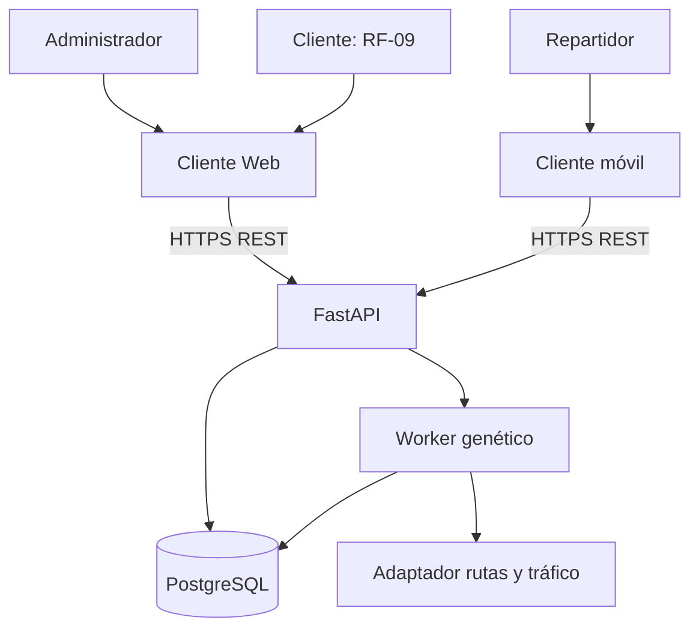

# EcoLogística Huancayo

Optimizador de rutas sostenibles para el caso académico DistriRápido S.A.C.

| Campo | Valor |
| --- | --- |
| Responsable | Jordy Steve Chancasanampa Torres |
| Curso | Taller de Proyectos 2 - Ingeniería de Sistemas e Informática |
| Modalidad | Individual, con adaptación Scrum documentada |
| Versión documental | 1.1.0 - revisión 07/10/2026 |
| Versión objetivo del producto | v1.0.0-MVP; no publicada ni certificada |
| Stack elegido | Flutter Web/móvil, FastAPI/Python y PostgreSQL |
| Estado | Diseño y plan S1/S2 detallados; ajustes y cierre coordinados en la guía |

## Alcance y fuentes de evidencia

EcoLogística Huancayo es la propuesta del estudiante para el caso DistriRápido; evaluación en Lima (SJL, El Agustino, Santa Anita y Ate). Flutter Web ADMIN/CLIENTE, móvil REPARTIDOR, FastAPI y PostgreSQL. La documentación describe arquitectura, alcance y criterios de implementación; la [guía de ajustes y cierre](GUIA_DE_AJUSTES_Y_CIERRE.md) concentra tareas Jira, Figma, software y evidencias. No se presenta el plan como ejecución histórica.

## Navegación documental

### Fase 01 - Inicio

| Documento | Versión |
| --- | --- |
| [01. Selección del enfoque del proyecto](docs/01%20Inicio/01.%20Selecci%C3%B3n%20del%20enfoque%20del%20proyecto%20V_1_1_0.md) | 1.1.0 |
| [02. Acta de constitución](docs/01%20Inicio/02.%20Acta%20de%20constituci%C3%B3n%20V_1_1_0.md) | 1.1.0 |
| [03. Declaración de la visión](docs/01%20Inicio/03.%20Declaraci%C3%B3n%20de%20la%20visi%C3%B3n%20V_1_1_0.md) | 1.1.0 |
| [04. Registro de supuestos y restricciones](docs/01%20Inicio/04.%20Registro%20de%20supuestos%20y%20restricciones%20V_1_1_0.md) | 1.1.0 |
| [05. Registro de interesados](docs/01%20Inicio/05.%20Registro%20de%20interesados%20V_1_1_0.md) | 1.1.0 |
| [06. Requisitos funcionales](docs/01%20Inicio/06.%20Requisitos%20funcionales%20V_1_1_0.md) | 1.1.0 |
| [07. Requisitos no funcionales](docs/01%20Inicio/07.%20Requisitos%20no%20funcionales%20V_1_1_0.md) | 1.1.0 |
| [08. Usuarios](docs/01%20Inicio/08.%20Usuarios%20V_1_1_0.md) | 1.1.0 |
| [09. Reglas de negocio](docs/01%20Inicio/09.%20Reglas%20de%20negocio%20V_1_1_0.md) | 1.1.0 |
| [10. Stack tecnológico](docs/01%20Inicio/10.%20Stack%20tecnol%C3%B3gico%20V_1_1_0.md) | 1.1.0 |
| [11. Base de datos](docs/01%20Inicio/11.%20Base%20de%20datos%20V_1_1_0.md) | 1.1.0 |
| [12. Modelo C4](docs/01%20Inicio/12.%20Modelo%20C4%20V_1_1_0.md) | 1.1.0 |
| [13. Restricciones](docs/01%20Inicio/13.%20Restricciones%20V_1_1_0.md) | 1.1.0 |

### Fase 02 - Planificación

| Documento | Versión |
| --- | --- |
| [01 Transformando a ágil](docs/02%20Planificaci%C3%B3n/01%20Transformando%20a%20%C3%A1gil%20V_1_1_0.md) | 1.1.0 |
| [02 Artefactos Jira](docs/02%20Planificaci%C3%B3n/02%20Artefactos%20Jira%20V_1_1_0.md) | 1.1.0 |
| [03 Registro de riesgos](docs/02%20Planificaci%C3%B3n/03%20Registro%20de%20riesgos%20V_1_1_0.md) | 1.1.0 |
| [04 Presupuesto del proyecto](docs/02%20Planificaci%C3%B3n/04%20Presupuesto%20del%20proyecto%20V_1_1_0.md) | 1.1.0 |

### Fase 03 - Implementación: Sprint 1 y Sprint 2

Cuatro archivos independientes, versión 1.0.0, con apartados S1/S2: fechas propuestas, alcance 22/19 SP, cambios, mejoras y casos de aceptación. Se conservan los nombres exactos de ambas consignas.

- [01 Informe de estado del proyecto](docs/03%20Implementaci%C3%B3n/01%20Informe%20de%20estado%20del%20proyecto%20V_1_0_0.md)
- [02 Registro de Impedimentos](docs/03%20Implementaci%C3%B3n/02%20Registro%20de%20Impedimentos%20V_1_0_0.md)
- [03 Revisión del Sprint](docs/03%20Implementaci%C3%B3n/03%20Revisi%C3%B3n%20del%20Sprint%20V_1_0_0.md)
- [04 Retrospectiva del Sprint](docs/03%20Implementaci%C3%B3n/04%20Retrospectiva%20del%20Sprint%20V_1_0_0.md)

### Registro de revisión y siguientes actividades

- [Revisión documental, alcance y pendientes](REVISION_DOCUMENTAL.md).
- [Guía: cambios en Jira, imágenes, login y cierre](GUIA_DE_AJUSTES_Y_CIERRE.md).

## Diseño y gestión

Figma: [archivo de diseño](https://www.figma.com/design/gRNmDQ2ZkvYdIMnVBenjwp/EcoLog%C3%ADstica-Huancayo---Mockups-PFA). Declaración de la visión conserva las imágenes locales y define campos/estados. Jira: EHAPP, IDs canónicos, flujo To Do/In Progress/In Review/Done y Fix Version v1.0.0-MVP. La guía especifica las capturas a actualizar y conserva el material histórico.

## Estado observado del software

La organización objetivo separa clientes Web/móvil y API. Implementación S1 define base, login y RN-023 (5 s → 10 s → 5 min); S2 define flota/repartidores válidos, UX y contrato. [La guía](GUIA_DE_AJUSTES_Y_CIERRE.md) detalla las correcciones del prototipo externo y el orden para integrar las fuentes, probar y documentar el resultado.

## Arquitectura objetivo

Dos clientes desplegables, API común, autorización por rol/propiedad y cálculo centralizado. La separación de clientes es objetivo y se verificará durante Implementación.

## Hoja de ruta objetivo

Calendario propuesto: 12/10/2026-18/01/2027, siete sprints consecutivos de dos semanas. S1: 12-26/10, 22 SP; S2: 26/10-09/11, 19 SP. Ver Artefactos Jira para el calendario completo.

Login RN-023: 3 fallos → 5 s; siguiente fallo → 10 s; siguiente y posteriores → 300 s. Bloqueo en API, contador Web/móvil, persistencia ante recarga y reinicio tras login correcto.

## Criterios de entrega

Núcleo RF-01..RF-07 con aceptación verificable; RNF aplicables; DoD de Transformando a ágil; migraciones, OpenAPI, manuales y evidencias. Arquitectura/diseño no acreditan funcionamiento. La release del producto y las versiones documentales son independientes.

## Control de cambios

| Versión documental | Fecha | Cambio |
|---|---|---|
| 1.0.0 | 27/09/2026 | Documentación previa en Git. |
| 1.1.0 | 07/10/2026 | Revisión de 17 artefactos y README; requisitos/historias verificables y estado de evidencias corregido. Navegación ampliada a Implementación 1.0.0 y guía de ajustes; calendario y política RN-023 alineados. |

No se ejecutaron commits, push, publicación ni cambios en Jira/Figma/API/BD en esta revisión. Inicio y Planificación apuntan a 1.1.0; los cuatro nuevos documentos de Implementación comienzan en 1.0.0. Son versiones documentales independientes de la release del producto.

## Código preparado para el repositorio

Las fuentes se encuentran en [backend](backend/README.md), [base de datos](database/README.md), [Web](apps/web/README.md) y [base móvil](apps/mobile/README.md). Consulta [Preparación para GitHub](PREPARACION_GITHUB.md) para ejecutar la copia y revisar los pendientes. El código se copió del proyecto activo sin moverlo; la APK independiente sigue pendiente.
