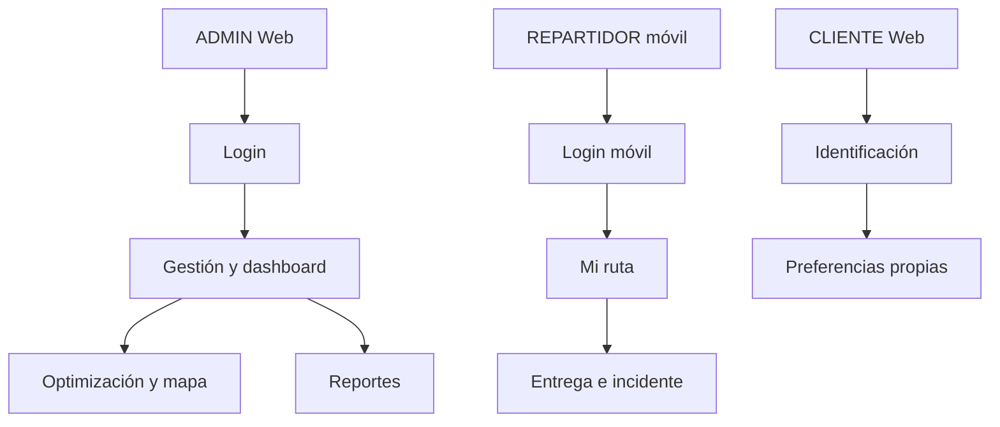

[⌂ README principal](../../README.md) | [← Anterior](07.%20Requisitos%20no%20funcionales%20V_1_1_0.md) | [Siguiente →](09.%20Reglas%20de%20negocio%20V_1_1_0.md)

# Identificación y perfiles de usuarios

| Campo | Valor |
| --- | --- |
| Proyecto | EcoLogística Huancayo - DistriRápido S.A.C. |
| Responsable | Jordy Steve Chancasanampa Torres |
| Modalidad | Individual; responsabilidades Scrum adaptadas |
| Fecha de revisión | 07/10/2026 |
| Versión documental | 1.1.0 |
| Estado | Especificación y plan de trabajo; validación según criterios de aceptación |

## Alcance y fuentes de evidencia

EcoLogística Huancayo es la propuesta del estudiante; el escenario de evaluación sigue siendo Lima (San Juan de Lurigancho, El Agustino, Santa Anita y Ate), con RF-01 a RF-10, RNF-01 a RNF-07 y RES-01 a RES-12. Los mapas de Huancayo son una demo adicional.

Arquitectura objetivo: Web ADMIN con preferencias CLIENTE (RF-09), móvil REPARTIDOR, FastAPI y PostgreSQL. Este documento define el diseño y sus criterios de validación. Las acciones de implementación, Jira, Figma y evidencias se coordinan en la guía de ajustes.

## Roles y necesidades

| Rol | Canal objetivo | Necesidad |
| --- | --- | --- |
| ADMIN | Web administrativa | Gestionar recursos, planificar, comparar rutas, analizar y generar reportes |
| REPARTIDOR | Móvil | Consultar asignación, próxima entrega y alertas; registrar estado e incidente |
| CLIENTE | Área restringida Web | Registrar horarios, referencias y restricciones propias (RF-09 complementario) |
| Sistema | API/servicios | Aplicar reglas y mantener trazabilidad |

## Matriz de acceso por rol y recurso

| Capacidad | ADMIN | REPARTIDOR | CLIENTE |
| --- | --- | --- | --- |
| Flota/repartidores | Crear, leer, actualizar e inactivar | Vehículo/perfil asignado: lectura | Sin acceso |
| Pedidos/clientes | Gestión | Datos mínimos de entregas asignadas | Solo identidad/preferencias propias; sin consulta global |
| Optimización/reoptimización | Ejecutar y confirmar | Reportar evento; sin ejecutar planificación global | Sin acceso |
| Rutas/mapa | Global | Solo asignadas | Sin acceso |
| Entrega/incidente | Consultar/gestionar | Actualizar propias | Sin acceso |
| Dashboard/PDF | Global/generar | Resumen operativo propio | Sin acceso |
| Preferencias | Registro asistido auditado | Solo referencia necesaria para entrega | Crear/leer/actualizar propias |
| Auditoría | Lectura autorizada | Sin acceso global | Sin acceso |

## Flujos de uso

Administrador: login → gestión de datos → validación → optimización → mapa/KPIs → confirmación → reporte. Repartidor: login → mi ruta → detalle → confirmar entrega o incidente → consultar actualización. Cliente: identificación → preferencias propias → guardar → confirmación.

## Aplicación de permisos

La ocultación de botones no acredita seguridad. El backend deriva identidad del token y filtra propiedad del recurso. Probar dos repartidores y dos clientes cruzando identificadores, token vencido y usuario inactivo. Mínimo dato personal visible en móvil; nunca acceso directo a PostgreSQL. La recuperación de sesión debe validar expiración y rol; encontrar un token guardado no acredita sesión vigente.

Aplicar RN-023 al acceso de todos los roles: bloqueo en API y contador visible, sin saltarlo desde otra pantalla o dispositivo. La consulta de rutas filtra por identidad y la administración requiere ADMIN. Verificación: casos de sesión, propietario y matriz de permisos.

## Historial de control de cambios

| Versión | Fecha | Responsable | Cambio |
|---|---|---|---|
| 1.0.0 | 27/09/2026 | Jordy Steve Chancasanampa Torres | Versión previa del repositorio; conservada en historial Git y respaldo de revisión. |
| 1.1.0 | 07/10/2026 | Jordy Steve Chancasanampa Torres | Refinamiento documental: requisitos verificables, trazabilidad, decisiones y estado real de evidencias. Calendario propuesto, RN-023 y guía de ajustes alineados. Sin modificación del software ni cierre de sprint. |

[⌂ README principal](../../README.md) | [← Anterior](07.%20Requisitos%20no%20funcionales%20V_1_1_0.md) | [Siguiente →](09.%20Reglas%20de%20negocio%20V_1_1_0.md)
