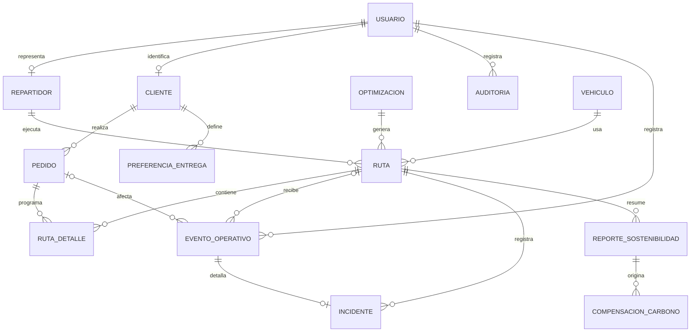

[⌂ README principal](../../README.md) | [Registro de revisión](../../REVISION_DOCUMENTAL.md) | [Guía de ajustes](../../GUIA_DE_AJUSTES_Y_CIERRE.md) | [← Anterior](10.%20Stack%20tecnol%C3%B3gico%20V_1_1_0.md) | [Siguiente →](12.%20Modelo%20C4%20V_1_1_0.md)

# 11. Diseño e ingeniería de base de datos

## 1. Metadatos

| Campo | Valor |
|---|---|
| Proyecto | **EcoLogística Huancayo - Optimizador de Rutas Sostenibles para DistriRápido S.A.C.** |
| Integrante | **Jordy Steve Chancasanampa Torres** |
| Modalidad | Proyecto individual |
| Fecha inicial | **27/09/2026** |
| Fecha de revisión | **07/10/2026** |
| Versión | **1.1.0** |
| Motor | PostgreSQL |

## 2. Modelo conceptual



> **Resumen del diagrama:** el pedido pertenece a un cliente; la ruta combina vehículo y repartidor; `ruta_detalle` conserva secuencia de pedidos; incidentes y reportes mantienen trazabilidad operativa.

## 3. Modelo lógico

| Entidad | PK | FK principales | Atributos clave | Normalización |
|---|---|---|---|---|
| usuario | usuario_id | - | email, password_hash, rol, estado | 3FN |
| vehiculo | vehiculo_id | - | placa, tipo, capacidad, consumo, factor_emision, año | 3FN |
| repartidor | repartidor_id | usuario_id | DNI, licencia, experiencia, disponibilidad, contacto | 3FN |
| cliente | cliente_id | usuario_id opcional único | nombre, contacto, estado | 3FN |
| preferencia_entrega | preferencia_id | cliente_id | horario, referencia, restricción | 3FN |
| pedido | pedido_id | cliente_id | dirección, GPS, peso, volumen, ventana, prioridad, tipo | 3FN |
| ruta | ruta_id | optimizacion_id, vehiculo_id, repartidor_id | algoritmo, distancia, tiempo, combustible, CO₂, estado | 3FN |
| ruta_detalle | ruta_detalle_id | ruta_id, pedido_id | secuencia, ETA, hora real, autor, estado_entrega | 3FN |
| incidente | incidente_id | ruta_id, repartidor_id | tipo, descripción, ubicación, fecha | 3FN |
| reporte_sostenibilidad | reporte_id | ruta_id opcional | periodo, CO₂, combustible, ahorro | 3FN |
| compensacion_carbono | compensacion_id | reporte_id | CO₂ objetivo, plan | 3FN |

## 4. Relaciones y cardinalidades

| Relación | Cardinalidad | Regla |
|---|---|---|
| Cliente-Pedido | 1:N | Un cliente puede tener múltiples pedidos. |
| Cliente-Preferencia | 1:N | Puede conservar distintas preferencias. |
| Vehículo-Ruta | 1:N | Un vehículo participa en múltiples rutas históricas. |
| Repartidor-Ruta | 1:N | Un repartidor puede ejecutar varias rutas en el tiempo. |
| Ruta-Pedido | N:M vía ruta_detalle | Permite secuencia y estado por asignación. |
| Ruta-Incidente | 1:N | Una ruta puede registrar varios eventos. |

## 5. Modelo físico DDL

```sql
CREATE EXTENSION IF NOT EXISTS pgcrypto;

CREATE TABLE usuario (
  usuario_id UUID PRIMARY KEY DEFAULT gen_random_uuid(),
  email VARCHAR(255) NOT NULL UNIQUE,
  password_hash VARCHAR(255) NOT NULL,
  rol VARCHAR(30) NOT NULL CHECK (rol IN ('ADMIN','REPARTIDOR','CLIENTE')),
  estado VARCHAR(20) NOT NULL DEFAULT 'ACTIVO',
  creado_en TIMESTAMPTZ NOT NULL DEFAULT CURRENT_TIMESTAMP
);

CREATE TABLE control_acceso (
  identificador_hmac VARCHAR(64) PRIMARY KEY,
  intentos_fallidos SMALLINT NOT NULL DEFAULT 0 CHECK (intentos_fallidos BETWEEN 0 AND 5),
  bloqueo_hasta TIMESTAMPTZ,
  actualizado_en TIMESTAMPTZ NOT NULL DEFAULT CURRENT_TIMESTAMP
);

CREATE TABLE vehiculo (
  vehiculo_id UUID PRIMARY KEY DEFAULT gen_random_uuid(),
  placa VARCHAR(15) NOT NULL UNIQUE,
  tipo VARCHAR(30) NOT NULL,
  capacidad_kg NUMERIC(10,2) NOT NULL CHECK (capacidad_kg > 0),
  capacidad_m3 NUMERIC(10,3) CHECK (capacidad_m3 > 0),
  consumo_km_l NUMERIC(8,3) NOT NULL CHECK (consumo_km_l > 0),
  factor_emision_kg_km NUMERIC(10,4) NOT NULL CHECK (factor_emision_kg_km >= 0),
  anio_fabricacion SMALLINT NOT NULL,
  estado VARCHAR(20) NOT NULL DEFAULT 'ACTIVO'
);

CREATE TABLE repartidor (
  repartidor_id UUID PRIMARY KEY DEFAULT gen_random_uuid(),
  usuario_id UUID NOT NULL UNIQUE REFERENCES usuario(usuario_id),
  nombre VARCHAR(160) NOT NULL,
  dni VARCHAR(20) NOT NULL UNIQUE,
  licencia VARCHAR(30) NOT NULL,
  categoria_licencia VARCHAR(20) NOT NULL,
  anios_experiencia SMALLINT CHECK (anios_experiencia >= 0),
  disponible_desde TIME,
  disponible_hasta TIME,
  origen_latitud NUMERIC(9,6) CHECK (origen_latitud BETWEEN -90 AND 90),
  origen_longitud NUMERIC(9,6) CHECK (origen_longitud BETWEEN -180 AND 180),
  contacto VARCHAR(50),
  CHECK ((disponible_desde IS NULL) = (disponible_hasta IS NULL)),
  CHECK ((origen_latitud IS NULL) = (origen_longitud IS NULL)),
  CHECK (disponible_desde IS NULL OR disponible_hasta IS NULL OR disponible_desde < disponible_hasta)
);

CREATE TABLE cliente (
  cliente_id UUID PRIMARY KEY DEFAULT gen_random_uuid(),
  usuario_id UUID UNIQUE REFERENCES usuario(usuario_id),
  nombre VARCHAR(160) NOT NULL,
  contacto VARCHAR(80),
  estado VARCHAR(20) NOT NULL DEFAULT 'ACTIVO'
);

CREATE TABLE preferencia_entrega (
  preferencia_id UUID PRIMARY KEY DEFAULT gen_random_uuid(),
  cliente_id UUID NOT NULL REFERENCES cliente(cliente_id),
  hora_preferida_inicio TIME,
  hora_preferida_fin TIME,
  punto_referencia TEXT,
  restriccion_acceso TEXT,
  registrado_por UUID NOT NULL REFERENCES usuario(usuario_id),
  origen VARCHAR(15) NOT NULL CHECK (origen IN ('DIRECTO','ASISTIDO')),
  registrado_en TIMESTAMPTZ NOT NULL DEFAULT CURRENT_TIMESTAMP,
  CHECK (hora_preferida_inicio IS NULL OR hora_preferida_fin IS NULL OR hora_preferida_inicio < hora_preferida_fin)
);

CREATE TABLE pedido (
  pedido_id UUID PRIMARY KEY DEFAULT gen_random_uuid(),
  cliente_id UUID NOT NULL REFERENCES cliente(cliente_id),
  direccion TEXT NOT NULL,
  punto_referencia TEXT,
  latitud NUMERIC(9,6) CHECK (latitud BETWEEN -90 AND 90),
  longitud NUMERIC(9,6) CHECK (longitud BETWEEN -180 AND 180),
  peso_kg NUMERIC(10,2) NOT NULL CHECK (peso_kg > 0),
  volumen_m3 NUMERIC(10,3) NOT NULL CHECK (volumen_m3 >= 0),
  ventana_inicio TIMESTAMPTZ NOT NULL,
  ventana_fin TIMESTAMPTZ NOT NULL,
  prioridad VARCHAR(20) NOT NULL CHECK (prioridad IN ('EXPRESS','ESTANDAR','ECONOMICO')),
  tipo_producto VARCHAR(30) NOT NULL CHECK (tipo_producto IN ('PERECEDERO','NO_PERECEDERO')),
  estado VARCHAR(20) NOT NULL DEFAULT 'BORRADOR' CHECK (estado IN ('BORRADOR','PENDIENTE','ASIGNADO','ENTREGADO','CANCELADO')),
  CHECK ((latitud IS NULL) = (longitud IS NULL)),
  CHECK (estado = 'BORRADOR' OR (latitud IS NOT NULL AND longitud IS NOT NULL)),
  CHECK (ventana_inicio < ventana_fin)
);

CREATE TABLE parametro_operativo (
  parametro_id UUID PRIMARY KEY DEFAULT gen_random_uuid(),
  codigo VARCHAR(80) NOT NULL,
  version INTEGER NOT NULL CHECK (version > 0),
  valores JSONB NOT NULL,
  unidad VARCHAR(50),
  fuente TEXT NOT NULL,
  vigente_desde TIMESTAMPTZ NOT NULL,
  vigente_hasta TIMESTAMPTZ,
  UNIQUE (codigo, version),
  CHECK (vigente_hasta IS NULL OR vigente_desde < vigente_hasta)
);

CREATE TABLE zona_restriccion (
  zona_id UUID PRIMARY KEY DEFAULT gen_random_uuid(),
  nombre VARCHAR(160) NOT NULL,
  geometria_geojson JSONB NOT NULL,
  tipo VARCHAR(40) NOT NULL,
  politica JSONB NOT NULL,
  fuente TEXT NOT NULL,
  verificado_en TIMESTAMPTZ,
  CHECK (jsonb_typeof(geometria_geojson) = 'object')
);

CREATE TABLE optimizacion (
  optimizacion_id UUID PRIMARY KEY DEFAULT gen_random_uuid(),
  anterior_id UUID REFERENCES optimizacion(optimizacion_id),
  solicitado_por UUID NOT NULL REFERENCES usuario(usuario_id),
  algoritmo VARCHAR(50) NOT NULL,
  version_motor VARCHAR(50) NOT NULL,
  semilla BIGINT NOT NULL,
  entradas_snapshot JSONB NOT NULL,
  parametros_snapshot JSONB NOT NULL,
  estado VARCHAR(20) NOT NULL CHECK (estado IN ('EN_CURSO','FACTIBLE','PARCIAL','SIN_SOLUCION','FALLIDA')),
  duracion_ms BIGINT CHECK (duracion_ms >= 0),
  resultado_diagnostico JSONB,
  creado_en TIMESTAMPTZ NOT NULL DEFAULT CURRENT_TIMESTAMP
);

CREATE TABLE ruta (
  ruta_id UUID PRIMARY KEY DEFAULT gen_random_uuid(),
  optimizacion_id UUID NOT NULL REFERENCES optimizacion(optimizacion_id),
  vehiculo_id UUID NOT NULL REFERENCES vehiculo(vehiculo_id),
  repartidor_id UUID NOT NULL REFERENCES repartidor(repartidor_id),
  estado VARCHAR(20) NOT NULL DEFAULT 'PLANIFICADA' CHECK (estado IN ('PLANIFICADA','CONFIRMADA','EN_CURSO','FINALIZADA','SUSTITUIDA')),
  algoritmo VARCHAR(50) NOT NULL,
  distancia_km NUMERIC(12,3) CHECK (distancia_km >= 0),
  tiempo_min NUMERIC(12,2) CHECK (tiempo_min >= 0),
  combustible_l NUMERIC(12,3) CHECK (combustible_l >= 0),
  co2_kg NUMERIC(12,3) CHECK (co2_kg >= 0),
  penalizacion_total NUMERIC(14,2) NOT NULL DEFAULT 0,
  creado_en TIMESTAMPTZ NOT NULL DEFAULT CURRENT_TIMESTAMP
);

CREATE TABLE ruta_detalle (
  ruta_detalle_id UUID PRIMARY KEY DEFAULT gen_random_uuid(),
  ruta_id UUID NOT NULL REFERENCES ruta(ruta_id) ON DELETE CASCADE,
  pedido_id UUID NOT NULL REFERENCES pedido(pedido_id),
  secuencia INTEGER NOT NULL CHECK (secuencia > 0),
  eta TIMESTAMPTZ,
  estado_entrega VARCHAR(20) NOT NULL DEFAULT 'PENDIENTE' CHECK (estado_entrega IN ('PENDIENTE','ENTREGADO','NO_ENTREGADO','CANCELADO')),
  entregado_en TIMESTAMPTZ,
  registrado_por UUID REFERENCES usuario(usuario_id),
  CHECK ((estado_entrega = 'ENTREGADO') = (entregado_en IS NOT NULL)),
  CHECK (estado_entrega <> 'ENTREGADO' OR registrado_por IS NOT NULL),
  UNIQUE (ruta_id, secuencia),
  UNIQUE (ruta_id, pedido_id)
);

CREATE TABLE evento_operativo (
  evento_id UUID PRIMARY KEY,
  tipo VARCHAR(30) NOT NULL CHECK (tipo IN ('ENTREGA','NUEVO_PEDIDO','CANCELACION','ACCIDENTE','AVERIA')),
  ruta_id UUID REFERENCES ruta(ruta_id),
  pedido_id UUID REFERENCES pedido(pedido_id),
  registrado_por UUID NOT NULL REFERENCES usuario(usuario_id),
  ocurrido_en TIMESTAMPTZ NOT NULL,
  recibido_en TIMESTAMPTZ NOT NULL DEFAULT CURRENT_TIMESTAMP,
  datos JSONB NOT NULL,
  CHECK (ruta_id IS NOT NULL OR pedido_id IS NOT NULL)
);

CREATE TABLE incidente (
  incidente_id UUID PRIMARY KEY DEFAULT gen_random_uuid(),
  ruta_id UUID NOT NULL REFERENCES ruta(ruta_id),
  repartidor_id UUID NOT NULL REFERENCES repartidor(repartidor_id),
  tipo VARCHAR(30) NOT NULL,
  evento_id UUID NOT NULL UNIQUE REFERENCES evento_operativo(evento_id),
  descripcion TEXT,
  latitud NUMERIC(9,6) CHECK (latitud BETWEEN -90 AND 90),
  longitud NUMERIC(9,6) CHECK (longitud BETWEEN -180 AND 180),
  ocurrido_en TIMESTAMPTZ NOT NULL DEFAULT CURRENT_TIMESTAMP,
  CHECK ((latitud IS NULL) = (longitud IS NULL))
);

CREATE TABLE reporte_sostenibilidad (
  reporte_id UUID PRIMARY KEY DEFAULT gen_random_uuid(),
  ruta_id UUID REFERENCES ruta(ruta_id),
  periodo_inicio DATE NOT NULL,
  periodo_fin DATE NOT NULL,
  co2_kg NUMERIC(14,3) NOT NULL DEFAULT 0,
  combustible_l NUMERIC(14,3) NOT NULL DEFAULT 0,
  ahorro_estimado NUMERIC(14,2) NOT NULL DEFAULT 0,
  archivo_url TEXT,
  parametros_snapshot JSONB NOT NULL,
  calculos_snapshot JSONB NOT NULL,
  CHECK (periodo_inicio <= periodo_fin)
);

CREATE TABLE compensacion_carbono (
  compensacion_id UUID PRIMARY KEY DEFAULT gen_random_uuid(),
  reporte_id UUID NOT NULL REFERENCES reporte_sostenibilidad(reporte_id),
  co2_objetivo_kg NUMERIC(14,3) NOT NULL CHECK (co2_objetivo_kg >= 0),
  descripcion_plan TEXT NOT NULL,
  parametros_snapshot JSONB NOT NULL,
  estado VARCHAR(20) NOT NULL DEFAULT 'PROPUESTA' CHECK (estado IN ('PROPUESTA','EN_EJECUCION','VERIFICADA'))
);

CREATE TABLE auditoria (
  auditoria_id UUID PRIMARY KEY DEFAULT gen_random_uuid(),
  usuario_id UUID NOT NULL REFERENCES usuario(usuario_id),
  accion VARCHAR(80) NOT NULL,
  entidad VARCHAR(80) NOT NULL,
  recurso_id UUID,
  detalle JSONB NOT NULL,
  ocurrido_en TIMESTAMPTZ NOT NULL DEFAULT CURRENT_TIMESTAMP
);

CREATE INDEX idx_ruta_optimizacion ON ruta(optimizacion_id);
CREATE INDEX idx_optimizacion_fecha ON optimizacion(creado_en);
CREATE INDEX idx_auditoria_recurso ON auditoria(entidad, recurso_id);
CREATE INDEX idx_pedido_cliente ON pedido(cliente_id);
CREATE INDEX idx_pedido_estado ON pedido(estado);
CREATE INDEX idx_pedido_ventana ON pedido(ventana_inicio, ventana_fin);
CREATE INDEX idx_ruta_vehiculo ON ruta(vehiculo_id);
CREATE INDEX idx_ruta_repartidor ON ruta(repartidor_id);
CREATE INDEX idx_ruta_estado ON ruta(estado);
CREATE INDEX idx_ruta_detalle_pedido ON ruta_detalle(pedido_id);
CREATE INDEX idx_incidente_ruta ON incidente(ruta_id);
```

> **Resumen del DDL:** este DDL es el diseño objetivo; especifica PK/FK, validaciones básicas e índices frecuentes. No acredita despliegue. Las migraciones reales deberán versionarse y no ejecutarse manualmente en producción.

---

## Extensiones del modelo lógico objetivo

| Entidad/relación | Clave y propósito | Integridad y normalización |
| --- | --- | --- |
| cliente.usuario_id | Identidad del cliente para RF-09; FK única opcional hasta habilitar acceso | Usuario y perfil separados; CLIENTE solo recurso propio |
| parametro_operativo | PK parámetro; UNIQUE código/versión; unidad/fuente/vigencia | Catálogo versionado; JSONB para valores de configuración |
| zona_restriccion | PK zona; geometría y política con fuente | Geometría GeoJSON validada en servicio; PostGIS evaluable posteriormente |
| optimizacion | PK ejecución; FK a ejecución anterior y autor | Snapshots deliberados para reproducibilidad; no sustituir datos maestros |
| ruta.optimizacion_id | FK de ruta a ejecución | Distinguir versiones y medir duración completa |
| ruta_detalle.entregado_en / registrado_por | Hora real y autor de entrega | Medir puntualidad y distinguir ETA de ejecución |
| evento_operativo | UUID idempotente; FK usuario, ruta/pedido | Persistir entregas y disparadores RF-07; aplicar evento y cambios en una transacción, sin duplicar efectos |
| incidente.evento_id | FK única a evento_operativo | Tipos/propiedad coincidentes comprobados por servicio |
| control_acceso | PK HMAC del identificador normalizado; intentos 0..5 y bloqueo_hasta | Estado compartido RN-023; incremento/plazo atómico, sin contraseña/token; no depende de existencia de cuenta |
| auditoria | FK usuario, acción, recurso, fecha | No almacenar contraseña, token ni datos sensibles innecesarios |
| reporte/compensacion snapshots | Parámetros y cálculos del periodo | Conservar fuentes y supuestos de resultados históricos |

## Estados, relaciones y reglas de servicio

Pedido: BORRADOR → PENDIENTE → ASIGNADO → ENTREGADO; CANCELADO es terminal antes de entrega. Ruta: PLANIFICADA → CONFIRMADA → EN_CURSO → FINALIZADA, con sustitución por una nueva versión sin borrar historial. La API valida transiciones, propiedad de recurso, compatibilidad del conductor, zona y asignación activa única. La relación histórica Ruta-Pedido puede contener versiones; un pedido no puede estar duplicado dentro de una versión vigente. Incidente y ruta deben pertenecer al repartidor autenticado. La API valida coincidencia de pedido/ruta, tipo de evento y autor; persiste el evento y sus efectos atómicamente. Una retransmisión del mismo UUID devuelve el resultado previo; si cambia su contenido se rechaza. Las horas reales no se derivan de ETA.

Los datos maestros se diseñan en 3FN: los atributos del vehículo, cliente y repartidor dependen de su PK. Snapshots de ejecución/reporte son desnormalización intencional e inmutable para auditoría. Prohibir eliminación física de maestros con historial; inactivar. Turnos nocturnos o multidiarios requieren intervalos fechados en una ampliación del esquema, no reinterpretar el CHECK TIME del turno diario inicial.

## Diferencias verificadas con el código existente

El DDL define el contrato de persistencia. Implementar migraciones explícitas y probar upgrade/conservación de datos. control_acceso almacena el contador saturado en 5 y el plazo RN-023: fallos 3/4/5 producen 5/10/300 s. Operar por identificador HMAC con clave backend y exclusión concurrente; no reiniciar registros durante el bloqueo. Un acceso correcto restablece 0 y elimina bloqueo_hasta. La auditoría conserva solo información operativa necesaria. Las brechas concretas del prototipo y su orden de corrección están en la guía de ajustes.

## Historial de control de cambios

| Versión | Fecha | Responsable | Cambio |
|---|---|---|---|
| 1.0.0 | 27/09/2026 | Jordy Steve Chancasanampa Torres | Versión previa del repositorio; conservada en historial Git y respaldo de revisión. |
| 1.1.0 | 07/10/2026 | Jordy Steve Chancasanampa Torres | Refinamiento documental: requisitos verificables, trazabilidad, decisiones y estado real de evidencias. Calendario propuesto, RN-023 y guía de ajustes alineados. Sin modificación del software ni cierre de sprint. |

[⌂ README principal](../../README.md) | [Registro de revisión](../../REVISION_DOCUMENTAL.md) | [Guía de ajustes](../../GUIA_DE_AJUSTES_Y_CIERRE.md) | [← Anterior](10.%20Stack%20tecnol%C3%B3gico%20V_1_1_0.md) | [Siguiente →](12.%20Modelo%20C4%20V_1_1_0.md)
