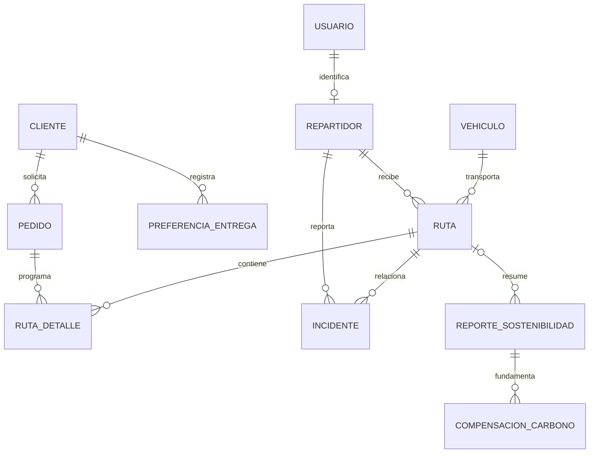

[README principal](../../README.md)

# Diseño e ingeniería de base de datos

| Campo | Valor |
| --- | --- |
| Proyecto | EcoLogística Huancayo - DistriRápido S.A.C. |
| Responsable | Jordy Steve Chancasanampa Torres |
| Fecha de revisión | 09/10/2026 |
| Versión documental | 1.2.0 |
| Motor | PostgreSQL 16 |
| Línea técnica | Migraciones 0001_initial_schema → 0002_access_resources → 0003_route_geometry → 0004_route_schedule |

## Modelo conceptual



`control_acceso` mantiene la política por identificador HMAC, independiente de la existencia de un usuario. `alembic_version` es una tabla técnica de control. Las tablas de preferencias, incidentes, reportes y compensación forman parte del esquema de dominio; una tabla no acredita por sí sola un flujo operativo.

## Modelo lógico, claves y normalización

| Entidad | PK | FK/relación | Atributos principales |
| --- | --- | --- | --- |
| usuario | usuario_id | email único | hash de contraseña, rol, estado y creación |
| control_acceso | identificador_hmac | Sin FK a usuario | intentos, bloqueo_hasta y actualización |
| vehiculo | vehiculo_id | placa única | tipo, capacidad, consumo, factor, año y estado |
| repartidor | repartidor_id | usuario_id único → usuario | nombre, DNI único, licencia, categoría, experiencia, contacto, horario, origen y estado |
| cliente | cliente_id | Entidad independiente | nombre, contacto y estado |
| preferencia_entrega | preferencia_id | cliente_id → cliente | horarios, referencia y restricción |
| pedido | pedido_id | cliente_id → cliente | dirección, referencia, GPS, peso, volumen, ventana, prioridad, producto y estado |
| ruta | ruta_id | vehiculo_id, repartidor_id | algoritmo, estado, origen, geometría, distancia, duración y campos ambientales |
| ruta_detalle | ruta_detalle_id | ruta_id, pedido_id | secuencia, ETA y estado_entrega |
| incidente | incidente_id | ruta_id, repartidor_id | tipo, descripción, ubicación y fecha |
| reporte_sostenibilidad | reporte_id | ruta_id opcional | periodo, CO₂, combustible, ahorro y archivo |
| compensacion_carbono | compensacion_id | reporte_id | CO₂ objetivo y descripción del plan |

Las entidades separan identidad, recursos y transacciones. Los atributos escalares dependen de su clave; `ruta_detalle` resuelve la relación entre ruta y pedido. `ruta.geometria` es un documento GeoJSON guardado como instantánea del recorrido. La aplicación impide asignar nuevamente un pedido ya programado; el diagrama expresa las relaciones del esquema, sin atribuir una restricción UNIQUE inexistente a pedido_id en ruta_detalle.

## Modelo físico DDL

El siguiente DDL procede de las migraciones del backend y coincide con [database/schema.sql](../../database/schema.sql). Es una instalación de estructura sin registros. Los UUID y valores por defecto del ORM se suministran desde el backend cuando el DDL no tiene DEFAULT de servidor.

```sql
BEGIN;

CREATE TABLE alembic_version (
    version_num VARCHAR(32) NOT NULL,
    CONSTRAINT alembic_version_pkc PRIMARY KEY (version_num)
);

-- Running upgrade  -> 0001_initial_schema

CREATE TABLE usuario (
    usuario_id UUID NOT NULL,
    email VARCHAR(255) NOT NULL,
    password_hash VARCHAR(255) NOT NULL,
    rol VARCHAR(30) NOT NULL,
    estado VARCHAR(20) NOT NULL,
    creado_en TIMESTAMP WITH TIME ZONE NOT NULL,
    PRIMARY KEY (usuario_id),
    UNIQUE (email)
);

CREATE INDEX ix_usuario_email ON usuario (email);

CREATE TABLE vehiculo (
    vehiculo_id UUID NOT NULL,
    placa VARCHAR(15) NOT NULL,
    tipo VARCHAR(30) NOT NULL,
    capacidad_kg NUMERIC(10, 2) NOT NULL,
    consumo_km_l NUMERIC(8, 3) NOT NULL,
    factor_emision_kg_km NUMERIC(10, 4) NOT NULL,
    anio_fabricacion INTEGER NOT NULL,
    estado VARCHAR(20) NOT NULL,
    PRIMARY KEY (vehiculo_id),
    UNIQUE (placa)
);

CREATE INDEX ix_vehiculo_placa ON vehiculo (placa);

CREATE TABLE repartidor (
    repartidor_id UUID NOT NULL,
    usuario_id UUID NOT NULL,
    nombre VARCHAR(160) NOT NULL,
    dni VARCHAR(20) NOT NULL,
    licencia VARCHAR(30) NOT NULL,
    categoria_licencia VARCHAR(20) NOT NULL,
    anios_experiencia INTEGER,
    disponible_desde TIME WITHOUT TIME ZONE,
    disponible_hasta TIME WITHOUT TIME ZONE,
    contacto VARCHAR(50),
    PRIMARY KEY (repartidor_id),
    UNIQUE (usuario_id),
    FOREIGN KEY(usuario_id) REFERENCES usuario (usuario_id),
    UNIQUE (dni)
);

CREATE TABLE cliente (
    cliente_id UUID NOT NULL,
    nombre VARCHAR(160) NOT NULL,
    contacto VARCHAR(80),
    estado VARCHAR(20) NOT NULL,
    PRIMARY KEY (cliente_id)
);

CREATE TABLE preferencia_entrega (
    preferencia_id UUID NOT NULL,
    cliente_id UUID NOT NULL,
    hora_preferida_inicio TIME WITHOUT TIME ZONE,
    hora_preferida_fin TIME WITHOUT TIME ZONE,
    punto_referencia TEXT,
    restriccion_acceso TEXT,
    PRIMARY KEY (preferencia_id),
    FOREIGN KEY(cliente_id) REFERENCES cliente (cliente_id)
);

CREATE TABLE pedido (
    pedido_id UUID NOT NULL,
    cliente_id UUID NOT NULL,
    direccion TEXT NOT NULL,
    punto_referencia TEXT,
    latitud NUMERIC(9, 6),
    longitud NUMERIC(9, 6),
    peso_kg NUMERIC(10, 2) NOT NULL,
    volumen_m3 NUMERIC(10, 3),
    ventana_inicio TIMESTAMP WITH TIME ZONE NOT NULL,
    ventana_fin TIMESTAMP WITH TIME ZONE NOT NULL,
    prioridad VARCHAR(20) NOT NULL,
    tipo_producto VARCHAR(30) NOT NULL,
    estado VARCHAR(20) NOT NULL,
    PRIMARY KEY (pedido_id),
    FOREIGN KEY(cliente_id) REFERENCES cliente (cliente_id)
);

CREATE TABLE ruta (
    ruta_id UUID NOT NULL,
    vehiculo_id UUID NOT NULL,
    repartidor_id UUID NOT NULL,
    estado VARCHAR(20) NOT NULL,
    algoritmo VARCHAR(50) NOT NULL,
    distancia_km NUMERIC(12, 3),
    tiempo_min NUMERIC(12, 2),
    combustible_l NUMERIC(12, 3),
    co2_kg NUMERIC(12, 3),
    penalizacion_total NUMERIC(14, 2) NOT NULL,
    creado_en TIMESTAMP WITH TIME ZONE NOT NULL,
    PRIMARY KEY (ruta_id),
    FOREIGN KEY(vehiculo_id) REFERENCES vehiculo (vehiculo_id),
    FOREIGN KEY(repartidor_id) REFERENCES repartidor (repartidor_id)
);

CREATE TABLE ruta_detalle (
    ruta_detalle_id UUID NOT NULL,
    ruta_id UUID NOT NULL,
    pedido_id UUID NOT NULL,
    secuencia INTEGER NOT NULL,
    eta TIMESTAMP WITH TIME ZONE,
    estado_entrega VARCHAR(20) NOT NULL,
    PRIMARY KEY (ruta_detalle_id),
    FOREIGN KEY(ruta_id) REFERENCES ruta (ruta_id),
    FOREIGN KEY(pedido_id) REFERENCES pedido (pedido_id)
);

CREATE TABLE incidente (
    incidente_id UUID NOT NULL,
    ruta_id UUID NOT NULL,
    repartidor_id UUID NOT NULL,
    tipo VARCHAR(30) NOT NULL,
    descripcion TEXT,
    latitud NUMERIC(9, 6),
    longitud NUMERIC(9, 6),
    ocurrido_en TIMESTAMP WITH TIME ZONE NOT NULL,
    PRIMARY KEY (incidente_id),
    FOREIGN KEY(ruta_id) REFERENCES ruta (ruta_id),
    FOREIGN KEY(repartidor_id) REFERENCES repartidor (repartidor_id)
);

CREATE TABLE reporte_sostenibilidad (
    reporte_id UUID NOT NULL,
    ruta_id UUID,
    periodo_inicio DATE NOT NULL,
    periodo_fin DATE NOT NULL,
    co2_kg NUMERIC(14, 3) NOT NULL,
    combustible_l NUMERIC(14, 3) NOT NULL,
    ahorro_estimado NUMERIC(14, 2) NOT NULL,
    archivo_url TEXT,
    PRIMARY KEY (reporte_id),
    FOREIGN KEY(ruta_id) REFERENCES ruta (ruta_id)
);

CREATE TABLE compensacion_carbono (
    compensacion_id UUID NOT NULL,
    reporte_id UUID NOT NULL,
    co2_objetivo_kg NUMERIC(14, 3) NOT NULL,
    descripcion_plan TEXT NOT NULL,
    PRIMARY KEY (compensacion_id),
    FOREIGN KEY(reporte_id) REFERENCES reporte_sostenibilidad (reporte_id)
);

INSERT INTO alembic_version (version_num) VALUES ('0001_initial_schema') RETURNING alembic_version.version_num;

-- Running upgrade 0001_initial_schema -> 0002_access_resources

CREATE TABLE control_acceso (
    identificador_hmac VARCHAR(64) NOT NULL,
    intentos_fallidos INTEGER DEFAULT '0' NOT NULL,
    bloqueo_hasta TIMESTAMP WITH TIME ZONE,
    actualizado_en TIMESTAMP WITH TIME ZONE NOT NULL,
    PRIMARY KEY (identificador_hmac),
    CONSTRAINT ck_access_attempts CHECK (intentos_fallidos BETWEEN 0 AND 5)
);

ALTER TABLE repartidor ADD COLUMN origen_latitud NUMERIC(9, 6);

ALTER TABLE repartidor ADD COLUMN origen_longitud NUMERIC(9, 6);

ALTER TABLE repartidor ADD COLUMN estado VARCHAR(20) DEFAULT 'ACTIVO' NOT NULL;

ALTER TABLE vehiculo ADD CONSTRAINT ck_vehicle_capacity CHECK (capacidad_kg > 0) NOT VALID;

ALTER TABLE vehiculo ADD CONSTRAINT ck_vehicle_consumption CHECK (consumo_km_l > 0) NOT VALID;

ALTER TABLE vehiculo ADD CONSTRAINT ck_vehicle_emissions CHECK (factor_emision_kg_km >= 0) NOT VALID;

ALTER TABLE repartidor ADD CONSTRAINT ck_driver_hours CHECK (disponible_desde IS NULL OR disponible_hasta IS NULL OR disponible_desde < disponible_hasta) NOT VALID;

ALTER TABLE repartidor ADD CONSTRAINT ck_driver_origin CHECK ((origen_latitud IS NULL) = (origen_longitud IS NULL)) NOT VALID;

ALTER TABLE repartidor ADD CONSTRAINT ck_driver_lat CHECK (origen_latitud BETWEEN -90 AND 90) NOT VALID;

ALTER TABLE repartidor ADD CONSTRAINT ck_driver_lon CHECK (origen_longitud BETWEEN -180 AND 180) NOT VALID;

UPDATE alembic_version SET version_num='0002_access_resources' WHERE alembic_version.version_num = '0001_initial_schema';

-- Running upgrade 0002_access_resources -> 0003_route_geometry

ALTER TABLE ruta ADD COLUMN origen_latitud NUMERIC(9, 6);

ALTER TABLE ruta ADD COLUMN origen_longitud NUMERIC(9, 6);

ALTER TABLE ruta ADD COLUMN geometria JSONB;

CREATE INDEX ix_ruta_detalle_pedido ON ruta_detalle (pedido_id);

UPDATE alembic_version SET version_num='0003_route_geometry' WHERE alembic_version.version_num = '0002_access_resources';

-- Running upgrade 0003_route_geometry -> 0004_route_schedule

ALTER TABLE ruta ADD COLUMN inicio_planificado TIMESTAMP WITH TIME ZONE;

ALTER TABLE ruta ADD COLUMN fin_planificado TIMESTAMP WITH TIME ZONE;

ALTER TABLE ruta ADD COLUMN servicio_min_por_entrega INTEGER;

ALTER TABLE ruta ADD CONSTRAINT ck_ruta_horario CHECK ((inicio_planificado IS NULL AND fin_planificado IS NULL AND servicio_min_por_entrega IS NULL) OR (inicio_planificado IS NOT NULL AND fin_planificado IS NOT NULL AND fin_planificado > inicio_planificado AND servicio_min_por_entrega BETWEEN 0 AND 120));

CREATE INDEX ix_ruta_repartidor_inicio ON ruta (repartidor_id, inicio_planificado);

CREATE INDEX ix_ruta_vehiculo_inicio ON ruta (vehiculo_id, inicio_planificado);

UPDATE alembic_version SET version_num='0004_route_schedule' WHERE alembic_version.version_num = '0003_route_geometry';

COMMIT;
```

## Integridad, índices y transacciones

| Control | Implementación |
| --- | --- |
| Identificadores | UUID por entidad; claves foráneas para perfiles, pedidos, rutas y detalles. |
| Duplicados | UNIQUE de email, placa, DNI y usuario_id del repartidor. La API normaliza y devuelve conflicto de dominio. |
| Flota | CHECK de capacidad/consumo >0 y emisiones ≥0; validación previa en API. |
| Perfil | CHECK de orden del horario, par de coordenadas y rangos geográficos. |
| Bloqueo | CHECK de intentos 0..5; bloqueo de fila y reloj del servidor en la política RN-023. |
| Asignación | Bloqueo de recursos/pedidos, comprobación de estado y capacidad; ruta, detalles y ASIGNADO se guardan en una transacción. |
| Índices | email, placa y ruta_detalle.pedido_id según DDL; las PK/UNIQUE generan sus índices PostgreSQL. |

Los CHECK de la migración 0002 usan NOT VALID para preservar compatibilidad histórica y controlar nuevas escrituras. La nulabilidad de columnas permite conservar registros previos; las altas actuales aplican las reglas Pydantic. El volumen existe en el esquema: el contrato de pedidos descrito en OpenAPI determina qué campos recibe la operación actual.

## Evolución y reproducción

Aplicar `alembic upgrade head` con DATABASE_URL del entorno. Usar schema.sql solo en una base vacía como alternativa inicial; el historial Alembic evita volver a aplicar revisiones ya registradas. Las ampliaciones se incorporan mediante nuevas migraciones, preservando el historial y respaldando los datos.

## Historial de control de cambios

| Versión | Fecha | Cambio |
| --- | --- | --- |
| 1.0.0 | 27/09/2026 | Diseño inicial del dominio. |
| 1.1.0 | 07/10/2026 | Refinamiento de relaciones y arquitectura de producto. |
| 1.2.0 | 09/10/2026 | Modelo conceptual/lógico y DDL sincronizados con la cadena real de migraciones. |

[README principal](../../README.md)

Actualización 09/10/2026: ruta incorpora inicio_planificado, fin_planificado y servicio_min_por_entrega; los horarios históricos se conservan nulos hasta su regularización. La API controla turnos y solapamientos bajo bloqueo de recursos.
