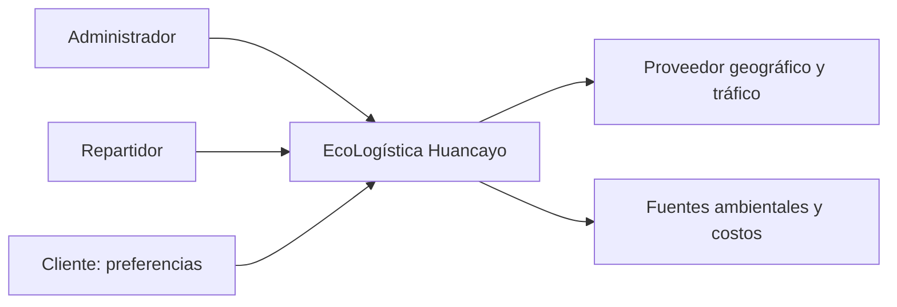
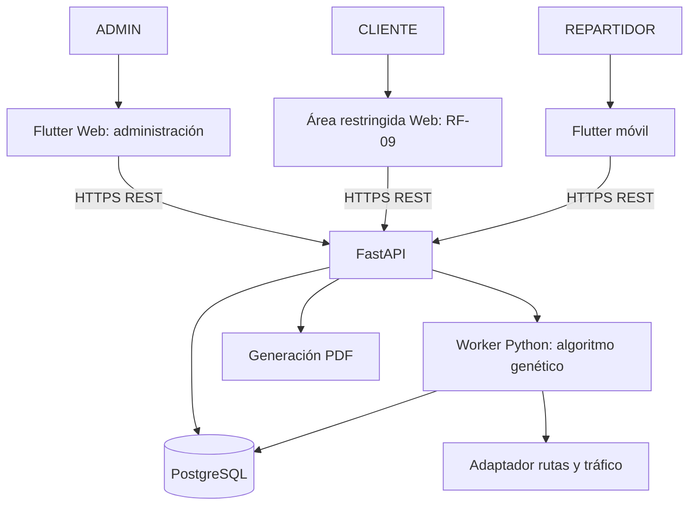
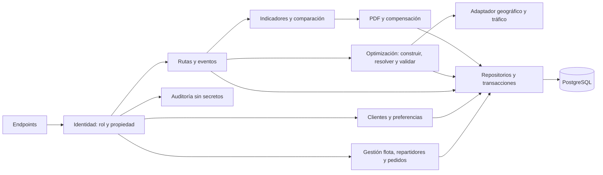
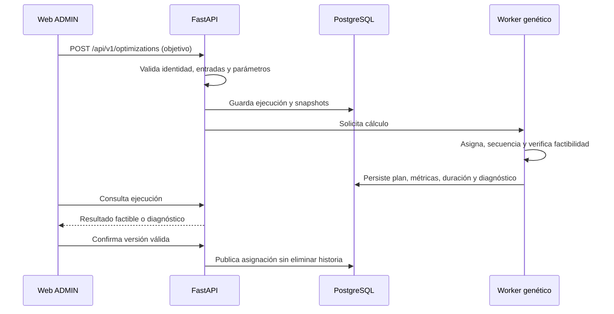
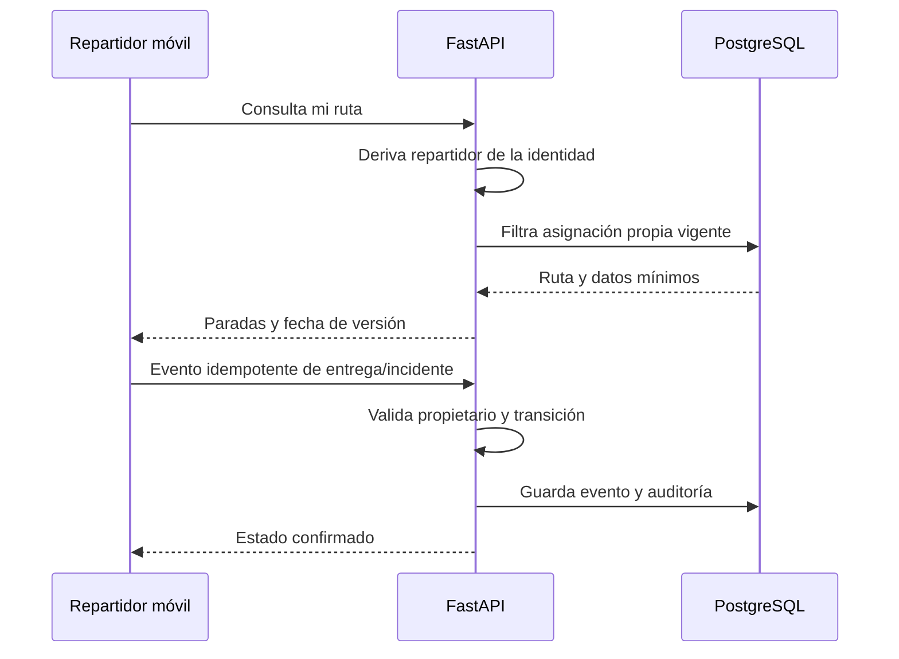
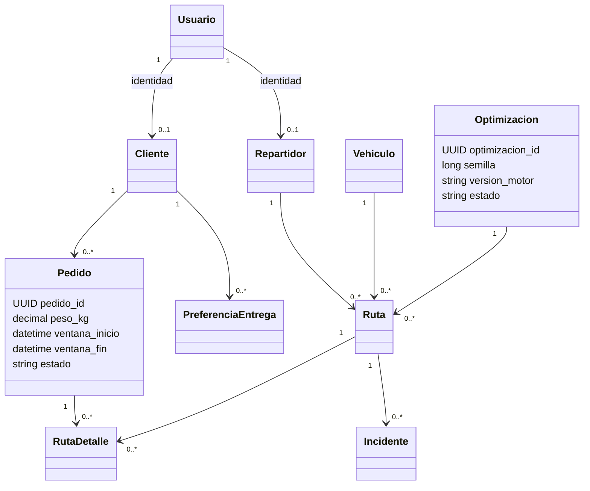
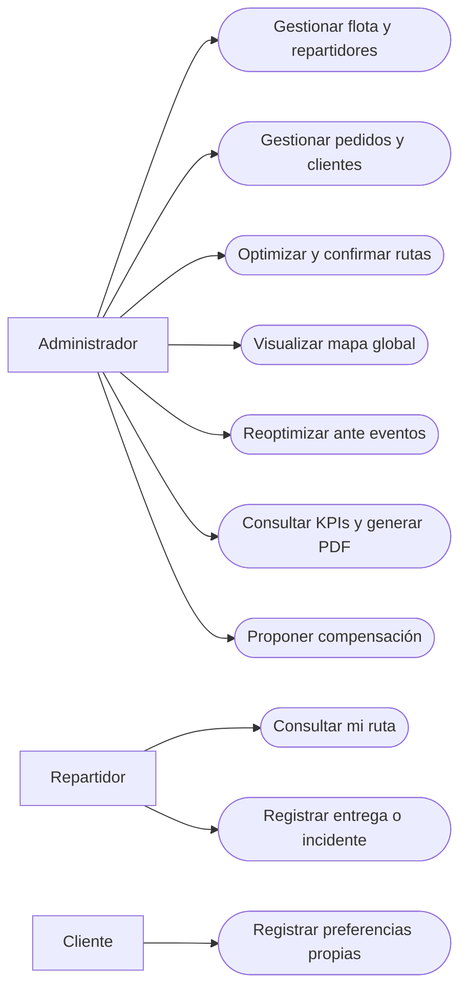
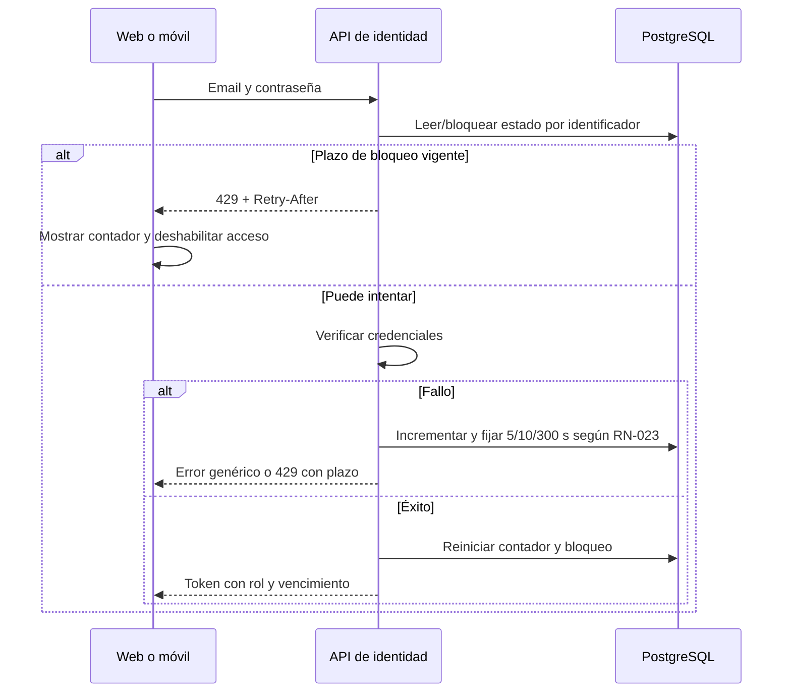

[⌂ README principal](../../README.md) | [Registro de revisión](../../REVISION_DOCUMENTAL.md) | [Guía de ajustes](../../GUIA_DE_AJUSTES_Y_CIERRE.md) | [← Anterior](11.%20Base%20de%20datos%20V_1_1_0.md) | [Siguiente →](13.%20Restricciones%20V_1_1_0.md)

# Arquitectura de software - Modelo C4

| Campo | Valor |
| --- | --- |
| Proyecto | EcoLogística Huancayo - DistriRápido S.A.C. |
| Responsable | Jordy Steve Chancasanampa Torres |
| Modalidad | Individual; responsabilidades Scrum adaptadas |
| Fecha de revisión | 07/10/2026 |
| Versión documental | 1.1.0 |
| Estado | Especificación y plan de trabajo; validación según criterios de aceptación |

## Alcance y fuentes de evidencia

EcoLogística Huancayo es la propuesta del estudiante; el escenario de evaluación sigue siendo Lima (San Juan de Lurigancho, El Agustino, Santa Anita y Ate), con RF-01 a RF-10, RNF-01 a RNF-07 y RES-01 a RES-12. Los mapas de Huancayo son una demo adicional.

Arquitectura objetivo: Web ADMIN con preferencias CLIENTE (RF-09), móvil REPARTIDOR, FastAPI y PostgreSQL. Este documento define el diseño y sus criterios de validación. Las acciones de implementación, Jira, Figma y evidencias se coordinan en la guía de ajustes.

## Estado arquitectónico

Los diagramas definen arquitectura de implementación: clientes Web/móvil independientes, API común, PostgreSQL, worker genético y módulos de eventos/reportes. El módulo de identidad controla rol, propiedad, sesión y RN-023. La guía de ajustes detalla las tareas para alinear el prototipo con este diseño.

## C4 nivel 1 - Contexto

El docente es interesado de evaluación, no usuario operativo de la aplicación. Las fuentes se identifican antes de afirmar datos actuales.

## C4 nivel 2 - Contenedores

Web y área cliente pertenecen al mismo despliegue Web con permisos distintos; móvil es cliente independiente objetivo. Worker es proceso de cómputo para no bloquear la API y guarda estado en BD. Reportes pueden ser módulo interno del backend. No se requiere un servicio externo de PDF por defecto.

## C4 nivel 3 - Componentes backend

## Flujo de optimización y confirmación

Contrato objetivo: POST /api/v1/optimizations, consulta de ejecución y confirmación de versión. Mantener OpenAPI y clientes alineados con esos endpoints; la guía registra el trabajo de implementación requerido.

## Flujo móvil y autorización por propietario

## UML complementario - Clases del dominio

## Casos de uso y alcance

ADMIN: gestionar recursos (US-003..006), optimizar (US-007), visualizar (US-008), reoptimizar (US-011), indicadores/PDF (US-012/013), compensación (US-014). REPARTIDOR: consultar (US-009), entrega/incidente (US-010). CLIENTE: preferencias propias (US-006). Autenticación y autorización son precondiciones transversales; el registro asistido se audita. El siguiente diagrama de casos de uso emplea nodos redondeados Mermaid para visualizar el alcance; no representa clases ni un flujo temporal. La validación del diseño por el docente se registrará cuando exista.

## Decisiones de calidad

Estado compartido en BD, cálculo fuera del hilo de atención, migraciones explícitas, adaptadores con timeout y fecha de dato, métricas por ejecución, caché móvil con última sincronización y eventos idempotentes. TLS, CORS limitado, secretos backend y autorización por rol/recurso son objetivos verificables; el wildcard CORS y tokens persistidos del prototipo requieren evaluación antes del release.

## Diagrama de casos de uso por actor

Precondición de todos los casos: identidad válida, autorización por rol y recurso. El detalle de entradas, salidas, alternativas y errores se especifica en RF e historias; los estados reales se comprobarán mediante pruebas de implementación.

## Secuencia de login y bloqueo RN-023

## Historial de control de cambios

| Versión | Fecha | Responsable | Cambio |
|---|---|---|---|
| 1.0.0 | 27/09/2026 | Jordy Steve Chancasanampa Torres | Versión previa del repositorio; conservada en historial Git y respaldo de revisión. |
| 1.1.0 | 07/10/2026 | Jordy Steve Chancasanampa Torres | Refinamiento documental: requisitos verificables, trazabilidad, decisiones y estado real de evidencias. Calendario propuesto, RN-023 y guía de ajustes alineados. Sin modificación del software ni cierre de sprint. |

[⌂ README principal](../../README.md) | [Registro de revisión](../../REVISION_DOCUMENTAL.md) | [Guía de ajustes](../../GUIA_DE_AJUSTES_Y_CIERRE.md) | [← Anterior](11.%20Base%20de%20datos%20V_1_1_0.md) | [Siguiente →](13.%20Restricciones%20V_1_1_0.md)
