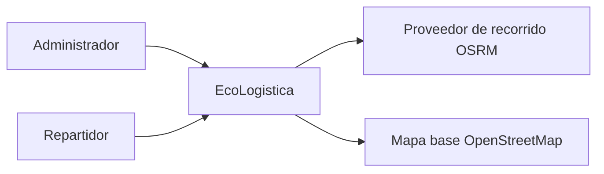
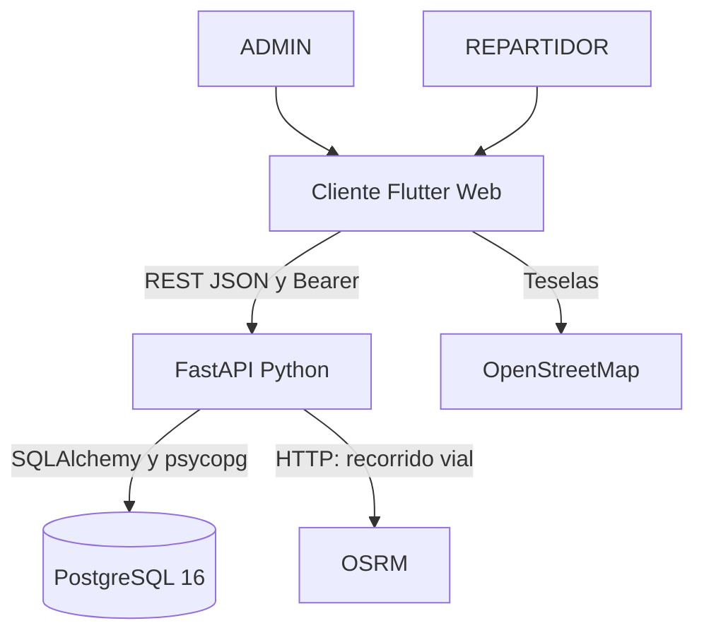
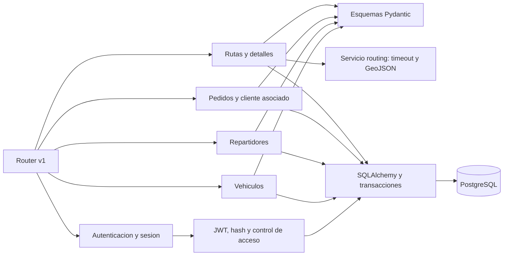
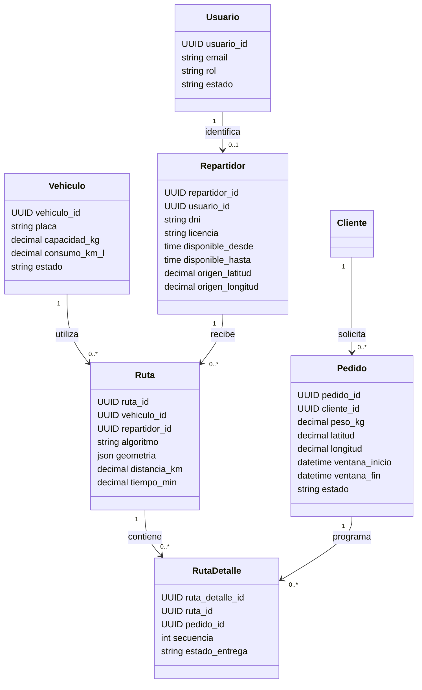
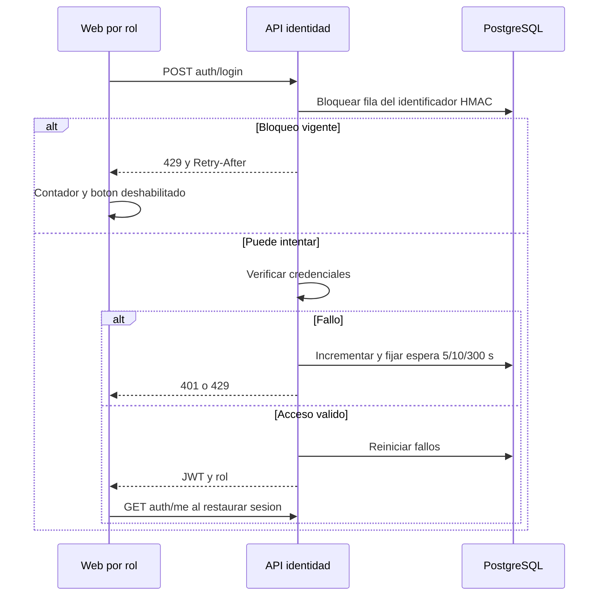
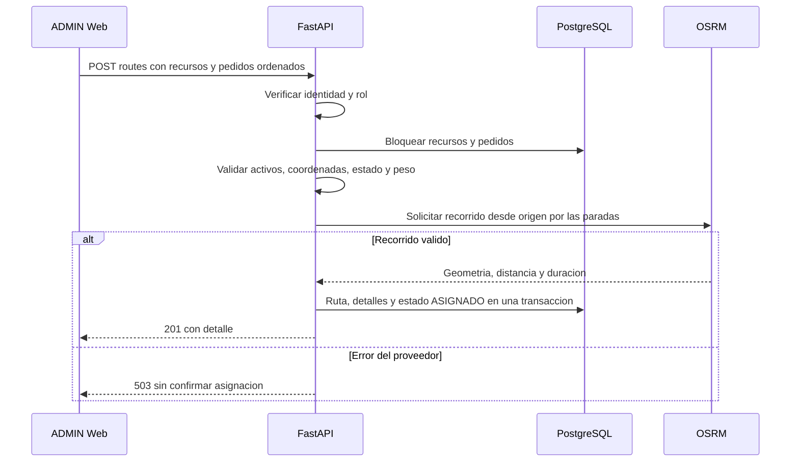
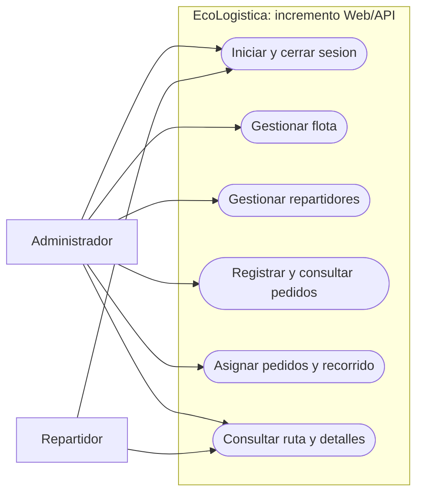

[README principal](../../README.md)

# Arquitectura de software - Modelo C4 y UML

| Campo | Valor |
| --- | --- |
| Proyecto | EcoLogística Huancayo - DistriRápido S.A.C. |
| Responsable | Jordy Steve Chancasanampa Torres |
| Fecha de revisión | 09/10/2026 |
| Versión documental | 1.2.0 |
| Alcance de este modelo | Incremento Web/API: acceso, recursos, pedidos, asignación y consulta de recorrido |

## C4 nivel 1: contexto

El administrador registra datos y asigna pedidos. El repartidor consulta sus asignaciones. El docente evalúa el producto y es interesado del proyecto; no es un usuario operativo. El cliente destinatario es una entidad del pedido dentro de este incremento.

## C4 nivel 2: contenedores

En ejecución local: Web 8080 y API 8000; la copia de entrega documenta Web 8081/API 8001 para operar de forma aislada. CORS enumera los orígenes permitidos. La API protege rol/propiedad y mantiene el estado de acceso en PostgreSQL. El backend solicita el recorrido; el navegador presenta geometría y marcadores.

## C4 nivel 3: componentes de la API

Correspondencia: `backend/app/api/routes`, `schemas.py`, `core/security.py`, `services/routing.py`, `models/entities.py` y `db/session.py`. Alembic mantiene el esquema; la configuración del servidor concentra conexión, CORS y claves.

## UML: clases del dominio del incremento

## UML: secuencia de login y RN-023

## UML: secuencia de asignación

## Casos de uso por actor

Representación funcional mediante nodos redondeados Mermaid, con actores y límite del sistema; complementa los diagramas UML de clases/secuencia.

Precondiciones: identidad vigente y rol permitido. ADMIN consulta las rutas globales; REPARTIDOR consulta solo su perfil/rutas. Entradas, validaciones y alternativas se especifican en RF, backlog y OpenAPI. El mapa representa una ruta planificada con orden elegido por el administrador.

## Decisiones y evolución de arquitectura

La arquitectura del producto se amplía por los incrementos del [roadmap](../02%20Planificaci%C3%B3n/02%20Artefactos%20Jira%20V_1_2_0.md). Cada módulo se incorpora mediante su contrato, migración y prueba de aceptación. El diseño de requisitos conserva el objetivo VRPTW/Green VRP y las funciones de sostenibilidad de la consigna. El cliente Android/iOS se organiza en `apps/mobile`, con API común y verificación por plataforma.

## Historial de control de cambios

| Versión | Fecha | Cambio |
| --- | --- | --- |
| 1.0.0 | 27/09/2026 | Arquitectura inicial. |
| 1.1.0 | 07/10/2026 | Diseño de producto y trazabilidad. |
| 1.2.0 | 09/10/2026 | C4/UML del incremento alineado con componentes, contratos y entidades del código. |

[README principal](../../README.md)
