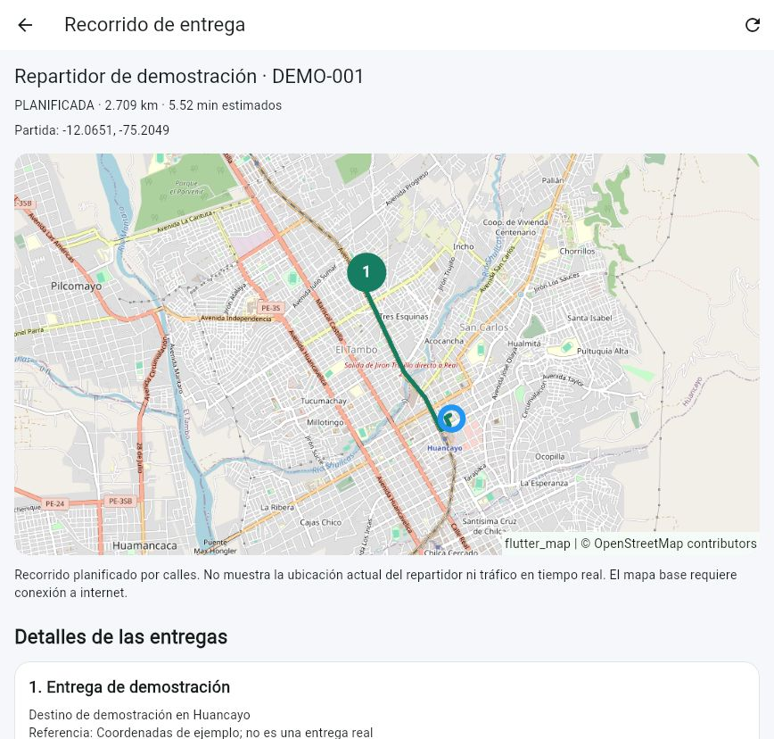
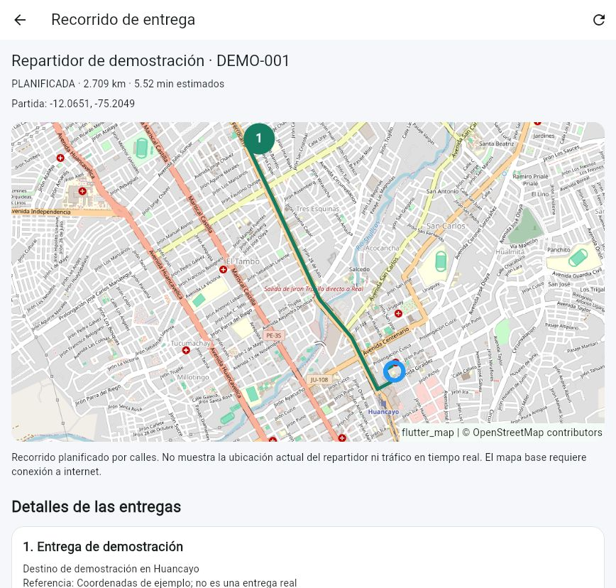

[README principal](../../README.md) | [Anterior](02%20Registro%20de%20Impedimentos%20V_1_0_0.md) | [Siguiente](04%20Retrospectiva%20del%20Sprint%20V_1_0_0.md)

# Revisión del Sprint

**Nombre del proyecto:** EcoLogística Huancayo - DistriRápido S.A.C.

**Líder del proyecto:** Jordy Steve Chancasanampa Torres

**Modalidad:** individual. **Versión documental:** 1.0.0. **Revisión de entrega:** 09/10/2026.

**Periodo del informe técnico:** 07/10/2026-09/10/2026; ejecuciones técnicas registradas el 07 y el 09/10/2026.

El documento presenta el avance técnico asociado al alcance de Sprint 1 y Sprint 2. El calendario del backlog es una línea base propuesta; las fechas de prueba identifican la evidencia real y no se atribuyen a ceremonias Scrum. La versión 1.0.0 conserva la nomenclatura de la primera entrega exigida por ambas consignas.

## Alcance de la revisión

Revisión técnica de los incrementos identificados como S1 y S2. Las pruebas iniciales se ejecutaron el 07/10/2026 y se ampliaron el 09/10/2026; el expediente incorpora la versión sincronizada de fuentes. Se distinguen implementación comprobada y aceptación de historias. Participante identificado: Jordy, responsable del proyecto. El recorrido de demostración es reproducible con los escenarios siguientes; los acuerdos externos se registran al realizar la presentación.

## Sprint 1

### Historias de Usuario completadas en este Sprint

El encabezado conserva la plantilla oficial. La siguiente tabla precisa el entregable comprobado por cada historia; el estado de aceptación se determina con el conjunto de sus criterios y plataforma.

| Elemento | SP de la línea base | Entregable comprobado | Evidencia |
| --- | ---: | --- | --- |
| US-001 | 3 | Login ADMIN Web, errores, logout y cuenta atrás | API 01/03; Flutter autenticación y login |
| EN-001-S1 | 3 | Organización de clientes/API y construcción Web | apps/web, apps/mobile, backend; registro de compilación |
| EN-002-S1 | 5 | Migración explícita y persistencia | Alembic 0001→0002→0003→0004; database/schema.sql |
| EN-007-S1 | 5 | Login adaptable, errores y estado bloqueado | Pruebas de pantalla y mockups de identidad |
| EN-003-S1 | 3 | Política atómica, sesión validada y autorización | API 01-03/06/08 |

### Demostración del trabajo completado

| Caso | Pasos del recorrido | Resultado verificado |
| --- | --- | --- |
| S1-C01 | Aplicar migraciones en la base aislada y arrancar API/Web | Arranque correcto; construcción Web y health satisfactorios en el registro técnico. |
| S1-C02 | Acceder como ADMIN/REPARTIDOR; comprobar token vencido e inactivación | Acceso válido por rol y rechazo de sesión sin vigencia. |
| S1-C03 | Consultar una ruta propia y otra de diferente repartidor | Propia 200; ajena 404; creación administrativa denegada al repartidor. |
| S1-C04 | Enviar fallos consecutivos 1, 2 y 3 | Primeros dos 401; tercer fallo 429 con espera de 5 s. |
| S1-C05 | Vencer de forma controlada el plazo de la identidad de prueba y volver a fallar | Esperas de 10 s y 300 s; Flutter representa el contador. |
| S1-C06 | Reintentar durante espera y restaurar el estado del cliente | El bloqueo no se extiende; el plazo se conserva. |
| S1-C07 | Acceder correctamente al vencer el bloqueo | El contador del servidor se reinicia y se emite un token válido. |
| S1-C08 | Enviar intentos concurrentes y simular error de comunicación en cliente | Transición atómica; sin atribuir un fallo de red a contraseña incorrecta. |

En API los plazos largos se vencieron exclusivamente sobre identidades de la base de pruebas. Esa técnica verifica la lógica sin afirmar que se esperaron cinco minutos reales ni que se probó un teléfono físico.

### Pendientes

US-002 móvil se acepta en S3 por replanificación del 09/10/2026. El seguimiento de S1 comprende los controles transversales de la DoD. Se administra con IMP-07-B/08 y el registro local de acciones de entrega, separado del detalle de funcionalidades demostradas.

## Sprint 2

### Historias de Usuario completadas en este Sprint

| Elemento | SP de la línea base | Entregable comprobado | Evidencia |
| --- | ---: | --- | --- |
| US-003 | 5 | Alta, lectura, edición e inactivación de flota; capacidad/consumo y placa válida | API 04; captura flota-validacion.jpg |
| US-004 | 5 | Alta/edición de perfil, cuenta vinculada, campos independientes y validaciones | API 05; formularios Web |
| EN-005-S2 | 3 | Etiquetas, foco, acciones visibles y distribución adaptable | Cuatro tamaños de pantalla; control WCAG en IMP-07-B |
| EN-007-S2 | 3 | Estados de carga, vacío, error y ayuda en formularios | Pruebas de UI y pantallas de administración |
| EN-009-S2 | 3 | Swagger/OpenAPI y guías con payloads y códigos HTTP | backend/README.md y /docs de la API |

### Demostración del trabajo completado

| Caso | Pasos del recorrido | Resultado verificado |
| --- | --- | --- |
| S2-C01 | Crear vehículo, leerlo, editarlo e inactivarlo | Los cambios se conservan; estado ACTIVO/INACTIVO controlado. |
| S2-C02 | Repetir placa y enviar capacidad/consumo cero | Conflicto 409 o validación 422, sin duplicar datos. |
| S2-C03 | Registrar perfil con identidad, licencia, contacto, horario y origen distintos | Campos conservados en sus propiedades; usuario vinculado. |
| S2-C04 | Repetir DNI/correo y enviar horario invertido | Rechazo controlado; inactivación del acceso asociada al perfil. |
| S2-C05 | Revisar login a 360×640, 768×1024, 1440×900 y 1200×500 | Cuatro pruebas de distribución aprobadas; controles accesibles identificados para evaluación. |
| S2-C06 | Repetir login/roles y contrastar endpoints con Swagger | Regresión API/Flutter aprobada en la ejecución registrada. |

### Avance adicional: asignación y mapa

ADMIN selecciona repartidor, vehículo y 1-20 pedidos ordenados. La API valida recursos activos, coordenadas y peso, consulta el trazado vial y guarda ruta/paradas con pedidos ASIGNADOS. Ambos roles abren el mismo recorrido; un repartidor ajeno no lo consulta. El recorrido es planificado y la selección del orden es manual.

Prueba API 08: creación 201, duplicado 409, entrada inválida 422, acceso indebido denegado y fallo del proveedor 503 sin asignación parcial. El ejemplo real devolvió 2.709 km, 5.52 min y 57 puntos; corresponde a datos sintéticos de Huancayo.

### Pendientes

Los controles de aceptación se siguen en IMP-07-B/08. La ampliación funcional continúa conforme al roadmap; las pruebas de asignación/mapa se registran como avance adicional y no sustituyen historias de optimización o sostenibilidad.

## Resultado y trazabilidad de la revisión

La ejecución registrada reúne **9 pruebas API y 29 pruebas Flutter aprobadas**, análisis sin incidencias y compilación Web. [Detalle técnico](evidencias/VERIFICACION_TECNICA.md) y [mapa/asignación](evidencias/ASIGNACION_Y_MAPA.md). Los resultados son técnicos; el cómputo de SP aceptados y los acuerdos de la Review corresponden a su acta de aceptación.

## Demostración ampliada del corte — 09/10/2026

| Caso | Operación | Evidencia / resultado |
| --- | --- | --- |
| S2-C07 | Alternar tema, abrir formularios y cambiar tamaño de pantalla. | Tablas/tarjetas y modales legibles; pruebas de contraste y validación en ambos temas. |
| S2-C08 | Contraer/expandir menú y seleccionar una sección. | Anchos de 80/248 px; selección y navegación conservadas. Dos pruebas de regresión. |
| S2-C09 | Revisar vehículos, repartidores y pedidos del conjunto ficticio. | 6 nuevas unidades con capacidades diferentes, 6 perfiles y 20 pedidos añadidos sin sustituir los anteriores. |
| AD-C01 | Abrir los 20 recorridos y consultar rutas con las seis cuentas ficticias. | 20 destinos y geometrías distintos; reparto 4/4/3/3/3/3, cada cuenta consulta exclusivamente sus rutas. |

[Interfaz y pruebas](evidencias/REVISION_UI_Y_PRUEBAS_20261009.md) · [Datos ficticios y totales](evidencias/DATOS_DE_PRUEBA_20261009.md). La asignación sigue siendo manual y el recorrido vial se obtiene del proveedor; estos casos no acreditan optimización genética, seguimiento GPS ni factibilidad de turnos.

## Ajuste de alcance y disponibilidad — 09/10/2026

US-002 móvil (3 SP) se traslada a Sprint 3 por decisión del responsable; S1/S2/S3 quedan en 19/19/22 SP. La base de identidad API/Web permanece en S1 y no se duplica el esfuerzo. El cierre S1 ya no incluye una demostración de APK.

US-004 incorpora validación efectiva de la asignación: fecha y hora de salida, fin calculado con viaje y atención, turno completo del repartidor y rechazo de cruces del repartidor o vehículo. La API serializa solicitudes y no modifica pedidos al rechazar. Las rutas antiguas requieren registrar su horario mediante el calendario de Rutas. [Funcionamiento, pruebas y límites](evidencias/DISPONIBILIDAD_20261009.md).

## Historial de control de cambios

| Versión | Fecha | Responsable | Cambio |
| --- | --- | --- | --- |
| 1.0.0 | 07/10/2026 | Jordy Steve Chancasanampa Torres | Primera redacción de alcance, controles y criterios S1/S2. |
| 1.0.0, revisión de entrega | 09/10/2026 | Jordy Steve Chancasanampa Torres | Consolidación de S1/S2 con fuentes sincronizadas, 29 pruebas Flutter, 9 API, mejoras UI y conjunto ficticio de 20 rutas. |

[README principal](../../README.md)
