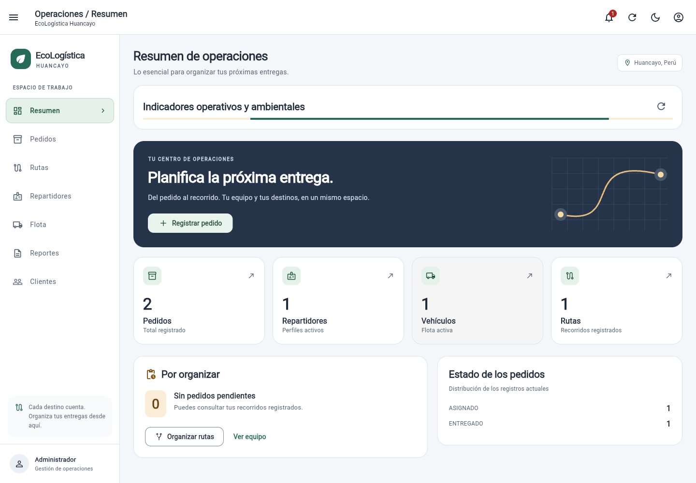
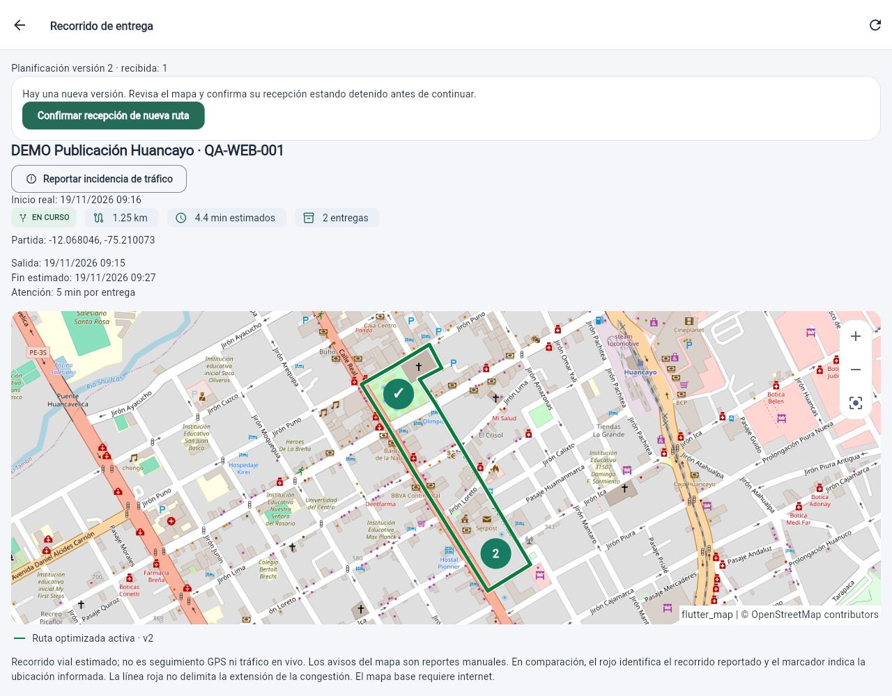
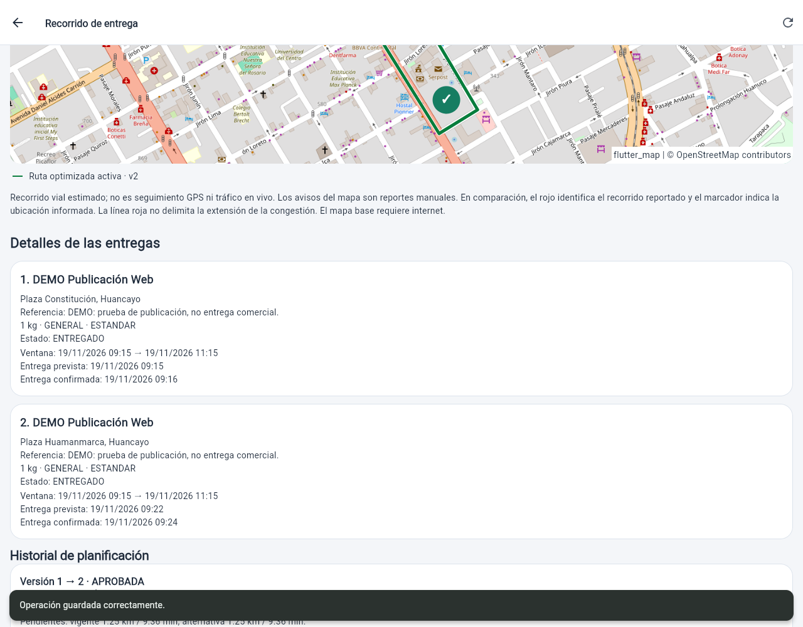

# Evidencias públicas explicadas — Semana 14

**Proyecto:** EcoLogística Huancayo. **Sprint:** 4. **Fecha de las pruebas y capturas:** 19/11/2026. **Revisión documental:** 19/11/2026. **Responsable:** Jordy Steve Chancasanampa Torres.

## Procedencia y alcance

Las imágenes y archivos siguientes pertenecen a la comprobación del despliegue público en [Wasmer](https://ecologistica-huancayo-web.wasmer.app/), conectado con FastAPI y Neon. Esta revisión organiza las evidencias ya existentes; **no es una nueva ejecución del flujo**. Se conservan los archivos originales y los resultados históricos sin alterar fechas ni inventar capturas.

Se utilizaron registros de demostración identificados como DEMO, dos destinos públicos de Huancayo y una incidencia simulada. Las capturas no representan entregas comerciales ni tráfico observado en tiempo real. No se incluyen contraseñas, claves de API, cookies de sesión ni conexión PostgreSQL. El expediente permite revisar resultados sin acceso privado al proveedor.

## 1. Aplicación pública y sesión ADMIN

**Qué se observa:** identidad Huancayo, menú de administración y conteos de dos pedidos, un repartidor, un vehículo y una ruta. La imagen se tomó en un momento intermedio: un pedido figuraba entregado y otro asignado. Los indicadores superiores todavía muestran carga en esta captura; no se presenta como evidencia de que todos sus gráficos hubieran terminado de cargar.

**Qué acredita:** acceso al panel y visualización de navegación/conteos con sesión ADMIN en el caso de prueba. Abrir una pantalla por sí solo no demuestra que todo su CRUD funcione. Las escrituras y sus validaciones se contrastan con el [reporte HTTP separado](../evidencias/20261119-despliegue-publico/verificacion-api-publica.json).

Las capturas complementarias documentan [Pedidos](../evidencias/20261119-despliegue-publico/capturas/web-admin-pedidos.png), [Rutas](../evidencias/20261119-despliegue-publico/capturas/web-admin-rutas.png), [Repartidores](../evidencias/20261119-despliegue-publico/capturas/web-admin-repartidores.png), [Flota](../evidencias/20261119-despliegue-publico/capturas/web-admin-flota.png), [Reportes](../evidencias/20261119-despliegue-publico/capturas/web-admin-reportes.png) y [Clientes](../evidencias/20261119-despliegue-publico/capturas/web-admin-clientes.png). Son apoyo visual de navegación; no sustituyen las comprobaciones de persistencia.

## 2. Recorrido en Huancayo y actualización para REPARTIDOR

**Qué se observa:** calles del centro de Huancayo, la ruta DEMO QA-WEB-001, estimaciones y la planificación versión 2. En ese instante, la versión recibida todavía era 1 y aparecía el botón «Confirmar recepción de nueva ruta». El mapa advierte que no ofrece seguimiento GPS ni tráfico en vivo.

**Qué acredita:** el repartidor pudo abrir su recorrido y se le presentó una actualización para revisar y confirmar. La captura muestra el estado **antes del acuse**; no se afirma que ya hubiera recibido la versión 2 solamente porque estaba dibujada.

**Cómo se completa la evidencia:** el [reporte del navegador](../evidencias/20261119-despliegue-publico/verificacion-web-publica.json) registra la confirmación por UI con respuesta HTTP 200. La [lectura final de PostgreSQL](../evidencias/20261119-despliegue-publico/persistencia-neon-final.json) registra versión 2 recibida y la revisión aprobada con fecha de recepción. Esa combinación acredita la transición y su conservación, no solo una imagen del mapa.

## 3. Entregas finalizadas e historial conservado

**Qué se observa:** Plaza Constitución y Plaza Huamanmarca, ambas en Huancayo, con estado ENTREGADO; el historial indica versión 1 → 2 aprobada y la interfaz informa «Operación guardada correctamente». Las fechas visibles de la web usan hora peruana; el JSON de PostgreSQL conserva marcas UTC con su zona explícita.

**Qué acredita:** la interfaz reflejó las entregas y la actualización aprobada. El reporte final además comprueba ruta FINALIZADA, versión 2 recibida y que el instante de la primera entrega no cambió después de reoptimizar. No se confundió aprobar una ruta en ADMIN con confirmar su recepción en REPARTIDOR.

## 4. Matriz de resultados y soporte técnico

| Comprobación | Resultado del 19/11 | Archivo que permite contrastarlo | Límite |
|---|---|---|---|
| Web y salud API | HTTP 200; archivo JavaScript servido coincide por SHA256 con la compilación pública. | [Cierre verificado](../evidencias/20261119-despliegue-publico/cierre-verificado.json). | Comprobación puntual; no certifica disponibilidad continua. |
| Contratos API | 41 comprobaciones de acceso, permisos, validación y flujo conformes en la ejecución registrada. | [Reporte API](../evidencias/20261119-despliegue-publico/verificacion-api-publica.json). | No equivale a 41 operaciones realizadas por botones. |
| Navegador real | 12 comprobaciones Chromium y 44 respuestas API observadas, sin errores de página ni 5xx en la ejecución final. | [Reporte web](../evidencias/20261119-despliegue-publico/verificacion-web-publica.json). | Incluye navegación y operaciones seleccionadas; no es una nueva campaña pública de tres motores. |
| Reoptimización y comunicación | Propuesta/aprobación, acuse de versión 2 y finalización comprobados entre API, UI y lectura de base. | [Persistencia final](../evidencias/20261119-despliegue-publico/persistencia-neon-final.json). | Incidencia simulada y dos destinos; no tráfico en vivo ni cobertura de toda la ciudad. |
| Entrega previa | Instante de primera entrega conservado. | Mismo informe de persistencia, `first_delivery_timestamp_unchanged`. | Comprobación del caso registrado, no garantía universal ante cualquier incidencia. |

El [informe de despliegue](../evidencias/20261119-despliegue-publico/RESULTADOS.md) explica los fallos de compatibilidad WASIX, arranque y variables, sus soluciones y la separación entre resultados locales y públicos. La campaña local del 18/11 mantiene su fecha y entorno; sus 30 ejecuciones E2E no se presentan como ejecutadas de nuevo en Wasmer.

## 5. Correspondencia con los documentos de Semana 14

| Documento | Evidencia que se utiliza | Explicación que sustenta |
|---|---|---|
| [Revisión del sprint](01%20Revisi%C3%B3n%20del%20Sprint%20V_1_0_0.md) | Capturas y reportes públicos de este expediente. | Qué se demostró en administración, reparto y persistencia; qué límites conserva el incremento. No atribuye aceptación al docente. |
| [Retrospectiva](02%20Retrospectiva%20del%20Sprint%20V_1_0_0.md) | Problemas y correcciones registrados en RESULTADOS. | Qué falló, cómo se resolvió y por qué se deben comprobar entorno, arranque y persistencia en cada publicación. |
| [Análisis Playwright](03%20Analisis%20PlayWrigth%20V_1_0_0.md) | Reportes de navegación pública y campaña local, identificados por separado. | Diferencia entre abrir una pantalla, ejecutar una acción, verificar su respuesta y comprobar datos guardados. |
| [Usabilidad SUS](04%20Usabilidad%20V_1_0_0.md) | Web disponible e instrumento preparado. | La URL permite aplicar tareas; **estas capturas no son respuestas SUS**. Faltan las cinco respuestas reales y su cálculo. |
| [Automatización CI/CD](12%20Automatizaci%C3%B3n%20CI-CD%20V_1_0_0.md) | Publicación manual y workflow local existente. | La URL demuestra publicación, pero **no ejecución de Actions ni CD Wasmer**. Faltan runs remotos y evidencia de entrega automática. |

## 6. Integridad y publicación segura

El [manifiesto de evidencia visual](../evidencias/20261119-despliegue-publico/MANIFIESTO_VISUAL.json) identifica por SHA256 las diez capturas existentes y los informes usados. Permite detectar si después cambia un archivo; un hash no demuestra por sí solo autenticidad, por eso se conserva la relación con los reportes y el contexto de prueba.

Antes de publicar PFA se revisará el diff completo y sus archivos preparados, porque esta comprobación documental no certifica todo el repositorio ni el historial Git. No deben incluirse `.env` privados, tokens, claves de firma, archivos de accesos, cookies, perfiles de navegador o respaldos de datos. Las capturas seleccionadas muestran registros DEMO y no requieren entregar credenciales al lector.

**Conclusión del expediente:** la publicación manual y el flujo público seleccionado tienen evidencia y explicación. SUS y automatización requieren resultados de su propia actividad y no se marcan aprobados usando capturas de otras pruebas.

[Índice del Sprint 4](README.md) · [Control de Semana 14](CONTROL_SEMANA14.md) · [README principal](../../../README.md).
